# Week 2 — White-Box Testing Report

## Report overview

This report presents the white-box testing of selected backend functions in
PyTodo Pro. The investigation examines database connection management, schema
initialisation, task conversion, category retrieval, and authentication
access control. Internal control flow is used to derive independent execution
paths and corresponding test cases. The existing pure-helper test suite is
also included in the statement-coverage evaluation.

The source under test is `app.py` and `helpers.py` in the repository root. The
executable tests are [test_app.py](test_app.py) and
[test_helpers.py](test_helpers.py). Environment preparation, dependency
installation, test commands, and coverage reproduction are documented in the
separate [setup guide](setup.md). The measured baseline was reproduced on
26 October 2026, Malaysia time.

## Deliverable checklist

- [x] [Task 1: Selected code units and justification](#task-1-selected-code-units-and-justification)
- [x] [Task 2: Control-flow analysis](#task-2-control-flow-analysis)
- [x] [Task 3: Cyclomatic complexity and white-box test cases](#task-3-cyclomatic-complexity-and-white-box-test-cases)
- [x] [Task 4: Automated test implementation](#task-4-automated-test-implementation)
- [x] [Task 5: Coverage interpretation and conclusion](#task-5-coverage-interpretation-and-conclusion)

## Task 1: Selected code units and justification

Table 1 below identifies the eight selected backend functions and explains
their relevance to the white-box investigation. A unit test isolates a callable
from external dependencies where appropriate; an integration test verifies its
interaction with Flask or SQLite. Both approaches can use white-box test design.

**Table 1. Selection and justification of backend code units.**

| Code unit | Responsibility and justification | Internal logic or risk examined | Test approach |
| --- | --- | --- | --- |
| `get_db` | Obtains the application-context database connection. Selection is justified by its central role in all persistent operations. | Connection creation versus reuse; context storage; named-row configuration; prevention of unnecessary connections. | Integration with a temporary SQLite database and Flask application context. |
| `close_connection` | Releases the context-owned database resource. Selection addresses resource lifecycle correctness. | Connection present versus absent; safe teardown; closure when an exception is supplied to the callback. | Unit tests with a mock connection, supplemented by real context-teardown integration. |
| `init_db` | Creates tables and inserts default categories. Selection addresses reproducible database preparation and repeated execution. | Zero and nonzero loop iterations; transaction commit; idempotent seeding; preservation of existing data. | Integration with temporary SQLite, including a test-only empty category configuration. |
| `row_to_task` | Converts a database-style record into the task representation consumed by the application. Selection addresses correctness at the data-transformation boundary. | Completed versus incomplete task; conditional urgency evaluation; Boolean conversion; field preservation and optional category value. | Unit tests using a dictionary record and mocked urgency computation. |
| `get_category_name` | Resolves a category identifier to its display name. Selection addresses optional relationships and missing database records. | Falsy identifier bypass; successful lookup; supplied identifier with no matching row. | Unit test for query bypass and SQLite integration for lookup outcomes. |
| `get_category_id_by_name` | Resolves a category name to its identifier. Selection addresses correct mapping from user-facing labels to stored records. | Matching versus absent result; parameterised query handling of unrecognised input. | Integration with seeded temporary categories. |
| `login_required_web` | Constructs a decorator that protects web views. Selection addresses the boundary between an unauthenticated request and an authorised view invocation. | Wrapper creation; missing/falsy session identifier; HTTP 302 redirect; argument forwarding; result and metadata preservation. | Unit tests with request contexts and a dummy callable; integration with the actual web endpoint. |
| `login_required_api` | Constructs a decorator that protects API views. Selection addresses consistent API authentication responses. | Wrapper creation; JSON error with HTTP 401; authenticated invocation; argument forwarding; result and metadata preservation. | Unit tests with request contexts and a dummy callable; integration with the actual API endpoint. |

Based on the table above, the selected units combine data integrity, resource
management, and access-control concerns. Their decisions are sufficiently
bounded to support explicit CFG construction and repeatable test inputs.

The four pure functions in `helpers.py`—`compute_urgency`, `is_valid_password`,
`is_valid_username`, and `completed_in_last_n_days`—are separately exercised by
the existing helper suite, summarised in Task 3.4, and evaluated in Tasks 4 and 5. The detailed
pseudocode, CFGs, and basis-path derivation in Tasks 2 and 3 concern the eight
backend functions selected above. Registration, credential verification, task
CRUD, and dashboard logic are outside the selected backend scope. A small
number of actual endpoint requests are retained to validate decorator
integration, rather than to claim comprehensive route coverage.

## Task 2: Control-flow analysis

### 2.1 Method and notation

The pseudocode follows the structured-English approach in Dalbey's
[Pseudocode Standard](https://users.csc.calpoly.edu/~jdalbey/SWE/pdl_std.html)
[1]. Uppercase control keywords, indentation, IF–THEN–ELSE decisions, and a
WHILE loop express the algorithms independently of Python syntax. PROCEDURE,
CALL, and RETURN identify callable boundaries, subroutine calls, and results.
The notation is adapted to these Python callables while retaining structured
selection and iteration rather than language-specific source syntax.

Each numbered pseudocode action corresponds to a node in the adjacent CFG.
An entry and a common exit are included, and each directed transition counts
as one edge. Multiple sequential actions may form one basic block. A diamond
represents a decision, and its True and False edges are labelled. Independent
calls are treated as atomic operations. Implicit exception edges inside Flask,
SQLite, and library calls are excluded from this normal-flow model. Thus,
complexity values refer to the stated abstraction, rather than to every
possible runtime failure.

For each decorator, construction and subsequent wrapper invocation are
separate callables. They are therefore shown as two connected-in-purpose but
separately counted CFGs. Executing the outer decorator does not itself evaluate
the session predicate.

The figures below use the requested side-by-side presentation: numbered
pseudocode on the left and the corresponding CFG on the right. Static SVG
figures preserve the layout in ordinary Markdown viewers. Matching Mermaid
source is provided immediately beneath every figure for inspection or editing.

### 2.2 `get_db`

**Figure 1. Pseudocode and CFG for get_db.**

| Pseudocode | Control-flow graph |
| --- | --- |
| <pre>[1] PROCEDURE get_db [2]     SET database TO context connection, or NONE [3]     IF database is NONE THEN [4]         CALL open SQLite connection and store in context [5]         SET row factory TO named-row access         ENDIF [6]     RETURN database [7] ENDPROCEDURE</pre> | 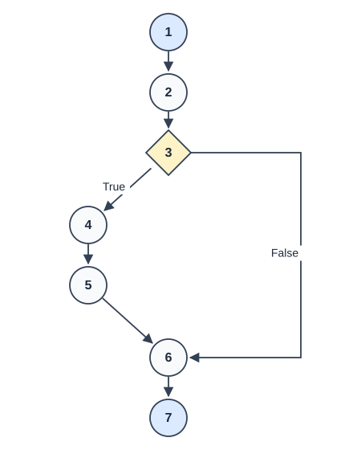 |

Based on Figure 1 above, the True edge creates a connection, whereas the False edge reuses the connection already associated with the application context.

Mermaid source for Figure 1

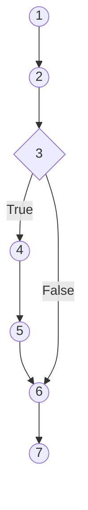

### 2.3 `close_connection`

**Figure 2. Pseudocode and CFG for close_connection.**

| Pseudocode | Control-flow graph |
| --- | --- |
| <pre>[1] PROCEDURE close_connection(exception) [2]     SET database TO context connection, or NONE [3]     IF database is not NONE THEN [4]         CALL close database connection         ENDIF [5] ENDPROCEDURE</pre> | 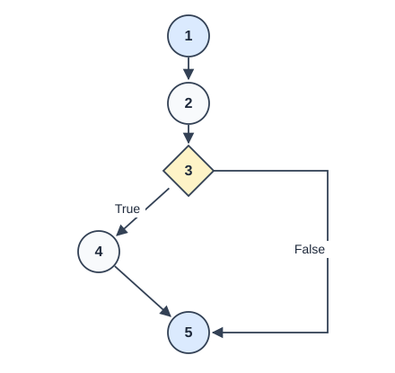 |

Based on Figure 2 above, the exception parameter is accepted by the teardown interface but is not inspected. Therefore, it does not introduce a decision in this function.

Mermaid source for Figure 2

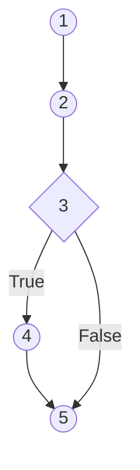

### 2.4 `init_db`

**Figure 3. Pseudocode and CFG for init_db.**

| Pseudocode | Control-flow graph |
| --- | --- |
| <pre>[1] PROCEDURE init_db [2]     ENTER application context and CALL get_db [3]     CALL create tables if absent         SET category iterator TO start of default categories [4]     WHILE another default category exists [5]         CALL insert category if absent             ADVANCE category iterator         ENDWHILE [6]     CALL commit database transaction [7]     LEAVE application context [8] ENDPROCEDURE</pre> | 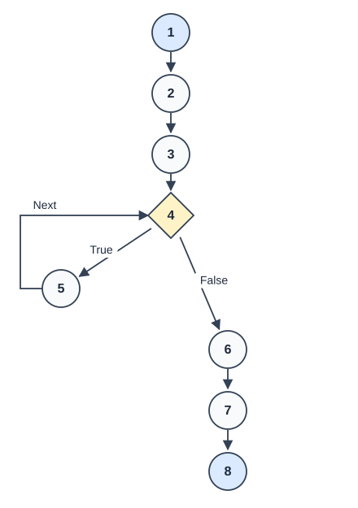 |

Based on Figure 3 above, the Python FOR loop is expressed as an equivalent iterator-controlled WHILE loop to expose its entry, back edge, and exit. SQL internals and the teardown callback are analysed separately rather than expanded into this graph. The second path uses the four production default categories.

Mermaid source for Figure 3

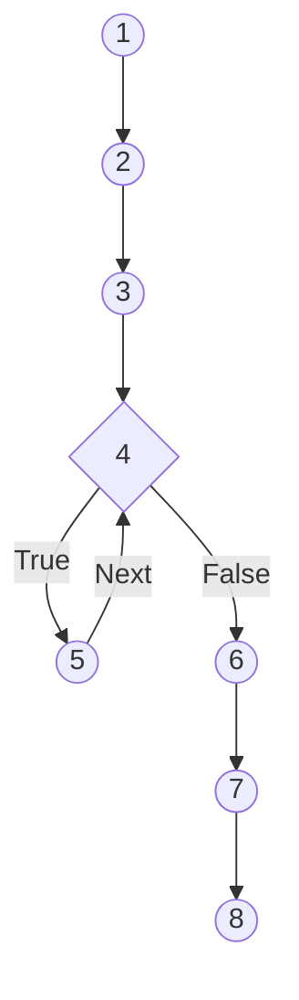

### 2.5 `row_to_task`

**Figure 4. Pseudocode and CFG for row_to_task.**

| Pseudocode | Control-flow graph |
| --- | --- |
| <pre>[1] PROCEDURE row_to_task(row, category_name) [2]     IF task is not completed THEN [3]         CALL compute_urgency with due date         ELSE [4]         SET urgency TO &quot;Done&quot;         ENDIF [5]     CREATE task mapping from row fields and category         CONVERT completion flag TO Boolean         INCLUDE selected urgency [6]     RETURN task mapping [7] ENDPROCEDURE</pre> | 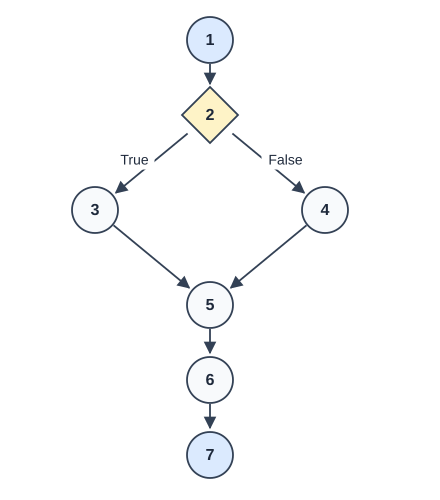 |

Based on Figure 4 above, the conditional expression inside the returned dictionary is expanded into a decision. Independent field assignments are grouped into one basic block; this preserves the path structure without reproducing Python dictionary syntax.

Mermaid source for Figure 4

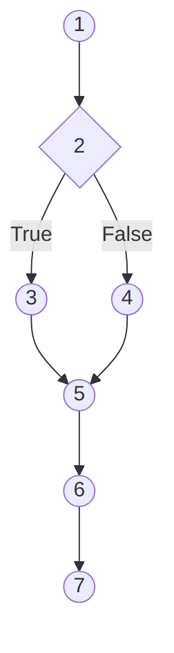

### 2.6 `get_category_name`

**Figure 5. Pseudocode and CFG for get_category_name.**

| Pseudocode | Control-flow graph |
| --- | --- |
| <pre>[1] PROCEDURE get_category_name(database, category_id) [2]     IF category_id is missing or falsy THEN [3]         RETURN NONE         ELSE [4]         CALL fetch category by parameterised identifier [5]         IF a matching row exists THEN [6]             RETURN category name             ELSE [7]             RETURN NONE             ENDIF         ENDIF [8] ENDPROCEDURE</pre> | 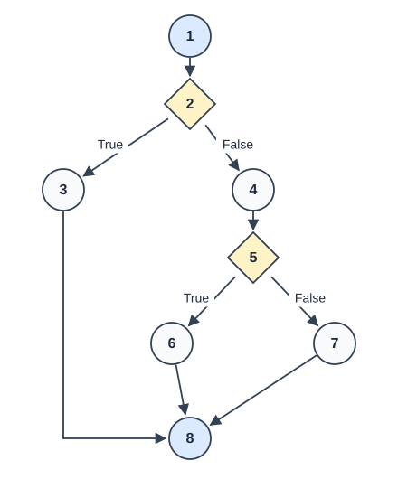 |

Based on Figure 5 above, the graph distinguishes a missing identifier, which bypasses the database, from a supplied identifier for which no row exists.

Mermaid source for Figure 5

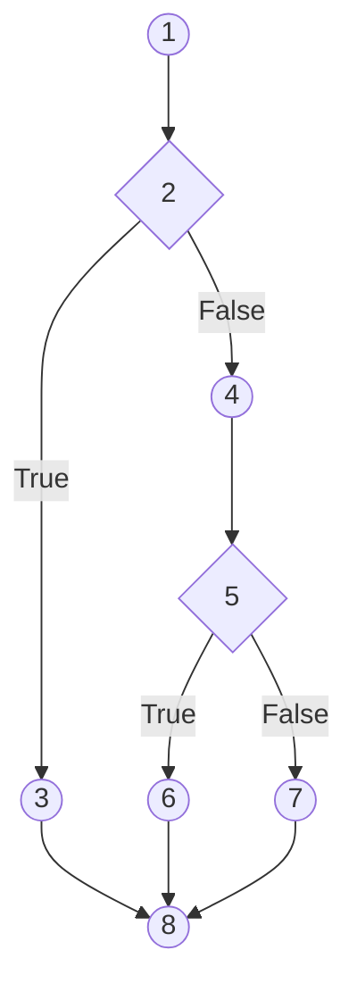

### 2.7 `get_category_id_by_name`

**Figure 6. Pseudocode and CFG for get_category_id_by_name.**

| Pseudocode | Control-flow graph |
| --- | --- |
| <pre>[1] PROCEDURE get_category_id_by_name(database, name) [2]     CALL fetch category by parameterised name [3]     IF a matching row exists THEN [4]         RETURN category identifier         ELSE [5]         RETURN NONE         ENDIF [6] ENDPROCEDURE</pre> | 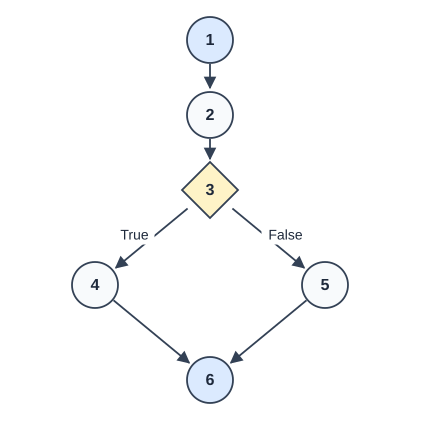 |

Based on Figure 6 above, the query is executed on both paths; the decision concerns the presence of a matching result.

Mermaid source for Figure 6

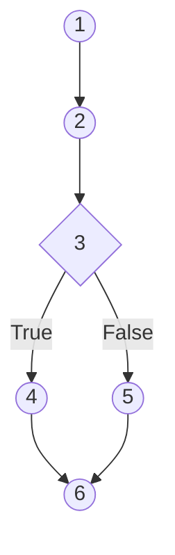

### 2.8 `login_required_web — decorator construction`

**Figure 7. Pseudocode and CFG for login_required_web — decorator construction.**

| Pseudocode | Control-flow graph |
| --- | --- |
| <pre>[1] PROCEDURE login_required_web(protected_function) [2]     DEFINE wrapper accepting positional and named arguments         PRESERVE protected function metadata [3]     RETURN wrapper [4] ENDPROCEDURE</pre> | 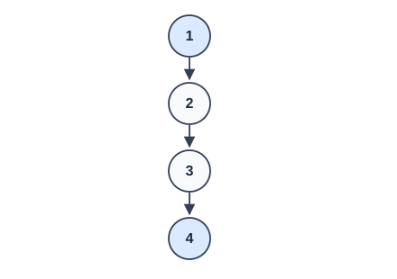 |

Based on Figure 7 above, decorator construction defines and returns a callable. It does not execute the session check until the returned wrapper is invoked.

Mermaid source for Figure 7

### 2.9 `login_required_web — wrapper invocation`

**Figure 8. Pseudocode and CFG for login_required_web — wrapper invocation.**

| Pseudocode | Control-flow graph |
| --- | --- |
| <pre>[1] PROCEDURE wrapper(arguments, named_arguments) [2]     IF session user identifier is missing or falsy THEN [3]         RETURN redirect response to login page (HTTP 302)         ELSE [4]         CALL protected_function with all arguments [5]         RETURN protected function result         ENDIF [6] ENDPROCEDURE</pre> | 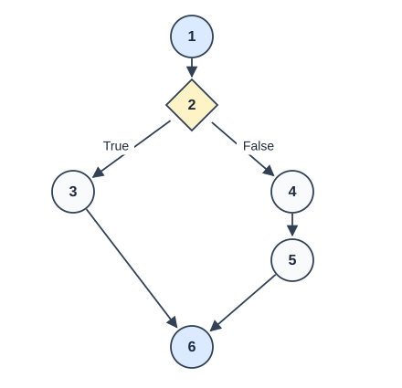 |

Based on Figure 8 above, the unauthenticated path returns immediately. The authenticated path forwards the original arguments and returns the protected function result without replacing it.

Mermaid source for Figure 8

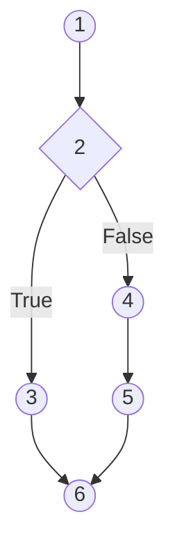

### 2.10 `login_required_api — decorator construction`

**Figure 9. Pseudocode and CFG for login_required_api — decorator construction.**

| Pseudocode | Control-flow graph |
| --- | --- |
| <pre>[1] PROCEDURE login_required_api(protected_function) [2]     DEFINE wrapper accepting positional and named arguments         PRESERVE protected function metadata [3]     RETURN wrapper [4] ENDPROCEDURE</pre> |  |

Based on Figure 9 above, decorator construction defines and returns a callable. It does not execute the session check until the returned wrapper is invoked.

Mermaid source for Figure 9

### 2.11 `login_required_api — wrapper invocation`

**Figure 10. Pseudocode and CFG for login_required_api — wrapper invocation.**

| Pseudocode | Control-flow graph |
| --- | --- |
| <pre>[1] PROCEDURE wrapper(arguments, named_arguments) [2]     IF session user identifier is missing or falsy THEN [3]         RETURN authentication error JSON and HTTP 401         ELSE [4]         CALL protected_function with all arguments [5]         RETURN protected function result         ENDIF [6] ENDPROCEDURE</pre> |  |

Based on Figure 10 above, the unauthenticated path returns immediately. The authenticated path forwards the original arguments and returns the protected function result without replacing it.

Mermaid source for Figure 10

## Task 3: Cyclomatic complexity and white-box test cases

### 3.1 Complexity calculation and coverage criterion

For a single connected CFG with one entry and one common exit, cyclomatic
complexity is calculated as:

$$
V(G) = E - N + 2
$$

Here, $E$ denotes the number of directed edges and $N$ denotes the number of
nodes, including entry and exit. Table 2 below applies this formula to the
exact graphs in Task 2. The calculation is a basis-path test-design measure
[4]; it is not a count of all possible executions.

**Table 2. Cyclomatic complexity of the selected callable graphs.**

| Graph | Nodes ($N$) | Edges ($E$) | Calculation | Independent basis paths |
| --- | ---: | ---: | --- | ---: |
| `get_db` | 7 | 7 | 7 − 7 + 2 | 2 |
| `close_connection` | 5 | 5 | 5 − 5 + 2 | 2 |
| `init_db` | 8 | 8 | 8 − 8 + 2 | 2 |
| `row_to_task` | 7 | 7 | 7 − 7 + 2 | 2 |
| `get_category_name` | 8 | 9 | 9 − 8 + 2 | 3 |
| `get_category_id_by_name` | 6 | 6 | 6 − 6 + 2 | 2 |
| `login_required_web — decorator construction` | 4 | 3 | 3 − 4 + 2 | 1 |
| `login_required_web — wrapper invocation` | 6 | 6 | 6 − 6 + 2 | 2 |
| `login_required_api — decorator construction` | 4 | 3 | 3 − 4 + 2 | 1 |
| `login_required_api — wrapper invocation` | 6 | 6 | 6 − 6 + 2 | 2 |

Based on the table above, each callable has low structural complexity. The
category-name function requires three independent paths because it contains
two decisions. The decorator factories require one path each, whereas their
wrappers require two paths each. Across the ten separately analysed callables,
19 basis paths are identified; this sum is a test-design inventory rather than
a cyclomatic-complexity calculation for the whole application.

The criterion used is **100% statement coverage and coverage of the defined
normal-flow basis paths for the selected backend functions**. It is not
exhaustive path coverage. In particular, the `init_db` loop admits execution
sequences with different iteration counts when its category list is varied.
The zero-iteration and four-iteration cases form an independent basis for this
CFG; testing those two representatives does not test every possible iteration
count. With the production list fixed to four elements, the zero-iteration path
is unavailable, so it is exercised through a test-only patched list.

### 3.2 Independent execution paths

Table 3 below lists complete entry-to-exit node sequences. The path identifiers
are reused in the derived test cases to maintain traceability.

**Table 3. Basis-path inventory.**

| Callable graph | Path ID | Node sequence |
| --- | --- | --- |
| `get_db` | DB01 | `[1 -> 2 -> 3 -> 4 -> 5 -> 6 -> 7]` |
| `get_db` | DB02 | `[1 -> 2 -> 3 -> 6 -> 7]` |
| `close_connection` | CL01 | `[1 -> 2 -> 3 -> 4 -> 5]` |
| `close_connection` | CL02 | `[1 -> 2 -> 3 -> 5]` |
| `init_db` | IN01 | `[1 -> 2 -> 3 -> 4 -> 6 -> 7 -> 8]` |
| `init_db` | IN02 | `[1 -> 2 -> 3 -> 4 -> 5 -> 4 -> 5 -> 4 -> 5 -> 4 -> 5 -> 4 -> 6 -> 7 -> 8]` |
| `row_to_task` | RT01 | `[1 -> 2 -> 3 -> 5 -> 6 -> 7]` |
| `row_to_task` | RT02 | `[1 -> 2 -> 4 -> 5 -> 6 -> 7]` |
| `get_category_name` | CN01 | `[1 -> 2 -> 3 -> 8]` |
| `get_category_name` | CN02 | `[1 -> 2 -> 4 -> 5 -> 6 -> 8]` |
| `get_category_name` | CN03 | `[1 -> 2 -> 4 -> 5 -> 7 -> 8]` |
| `get_category_id_by_name` | CI01 | `[1 -> 2 -> 3 -> 4 -> 6]` |
| `get_category_id_by_name` | CI02 | `[1 -> 2 -> 3 -> 5 -> 6]` |
| `login_required_web — decorator construction` | WF01 | `[1 -> 2 -> 3 -> 4]` |
| `login_required_web — wrapper invocation` | WA01 | `[1 -> 2 -> 3 -> 6]` |
| `login_required_web — wrapper invocation` | WA02 | `[1 -> 2 -> 4 -> 5 -> 6]` |
| `login_required_api — decorator construction` | AF01 | `[1 -> 2 -> 3 -> 4]` |
| `login_required_api — wrapper invocation` | AA01 | `[1 -> 2 -> 3 -> 6]` |
| `login_required_api — wrapper invocation` | AA02 | `[1 -> 2 -> 4 -> 5 -> 6]` |

Based on the table above, the union of the basis paths visits every modelled
node and edge of each selected callable. This structural argument is supported
by the input-to-path mapping below and by statement measurements in Task 5.
The default pytest-cov run measures statements; it does not record the named
basis-path sequences automatically.

### 3.3 Derived backend test cases

The test cases in Table 4 below state the preconditions and expected outcomes
for each basis path. Test names refer to the existing implementations in
`test_app.py`; class names are supplied where needed to disambiguate shared
parameterised cases.

**Table 4. Test cases derived from the selected CFGs.**

| Case / path | Preconditions and test data | Expected result and assertions | Automated evidence |
| --- | --- | --- | --- |
| DB01 | A fresh application context with no `_database` connection. | A SQLite connection is stored in `g`; `row_factory` is `sqlite3.Row`; a query supports named-column access. | `TestDatabaseHelpers.test_get_db_creates_and_reuses_connection`, first call. |
| DB02 | The same context already contains the connection created by DB01. | A second call returns the identical object; no replacement connection is created. | The same test, second call, with `is` identity assertion. |
| CL01 | The context contains a mock connection. | `close()` is called exactly once; an exception argument does not prevent closure. | `TestCloseConnection.test_closes_existing_connection` and `test_closes_connection_when_teardown_receives_exception`. |
| CL02 | The context contains no database connection. | No exception is raised; no connection attribute is introduced. | `TestCloseConnection.test_no_connection_is_safe`. |
| IN01 | A fresh temporary database and `DEFAULT_CATEGORIES` patched to `[]`. | The three tables exist; category count is zero; initialisation completes without entering the loop. | `TestDatabaseHelpers.test_init_db_with_no_default_categories`. |
| IN02 | A fresh temporary database and production defaults `Work`, `Personal`, `Study`, `Urgent`. | Four categories are committed; another connection can read them; expected tables and task defaults exist. | `TestDatabaseHelpers.test_init_db_creates_tables_and_commits_categories`. |
| RT01 | Record with `done=0`; due date `2026-10-22`; urgency mock returns `Due Soon`; category is `None` or `Study`. | Urgency computation receives the due date once; mapped fields are correct; completion becomes `False`; input is unchanged. | `test_row_to_task_converts_fields_and_selects_urgency`, `done=0` variants. |
| RT02 | Record with `done=1`; category is `None` or `Study`. | Urgency is `Done`; urgency computation is not called; completion becomes `True`; fields are preserved. | The same parameterised test, `done=1` variants. |
| CN01 | Identifier is `None`, `0`, or an empty string; mock database supplied. | Result is `None`; `database.execute` is never called. | `test_missing_category_id_skips_database`, three variants. |
| CN02 | Seeded database; obtain the actual identifier associated with `Study`. | Category name is exactly `Study`. | `TestDatabaseHelpers.test_category_lookups_find_seeded_category`. |
| CN03 | Seeded database; category identifier `999999` is absent. | Result is `None`. | `TestDatabaseHelpers.test_category_lookups_return_none_for_missing_values`. |
| CI01 | Seeded database; name is `Study`. | Returned identifier equals the independently queried identifier. | `TestDatabaseHelpers.test_category_lookups_find_seeded_category`. |
| CI02 | Name is `Unknown`; additionally use `Study' OR 1=1 --` as unrecognised input. | No matching row is returned; result is `None` for both inputs. | `TestDatabaseHelpers.test_category_lookups_return_none_for_missing_values`. |
| WF01 | A named dummy protected function with documentation. | A callable wrapper is returned; name, documentation, and `__wrapped__` reference are retained. | `TestAuthDecorators.test_preserves_wrapped_function_metadata`, web variant. |
| WA01 | Web wrapper; no `user_id` key, or value `0` or empty string. | HTTP 302 response redirects to `/login`; protected callable is not executed. | `TestAuthDecorators.test_unauthenticated_request_does_not_call_function`, web variants. |
| WA02 | Web wrapper; session `user_id=1`; arguments `7` and `category="Study"`. | Protected callable receives both arguments exactly once; its result is returned by identity. | `TestAuthDecorators.test_authenticated_request_forwards_arguments_and_result`, web variant. |
| AF01 | A named dummy protected function with documentation. | API wrapper is returned and preserves function metadata. | `TestAuthDecorators.test_preserves_wrapped_function_metadata`, API variant. |
| AA01 | API wrapper; no `user_id` key, or value `0` or empty string. | Response payload is `{"error": "authentication required"}` with HTTP 401; protected callable is not executed. | `TestAuthDecorators.test_unauthenticated_request_does_not_call_function`, API variants. |
| AA02 | API wrapper; session `user_id=1`; arguments `7` and `category="Study"`. | Protected callable receives the arguments exactly once; its original result is returned. | `TestAuthDecorators.test_authenticated_request_forwards_arguments_and_result`, API variant. |

Based on the table above, every basis path has an executable test mapping.
Some tests exercise multiple paths in sequence, while parameterisation expands
one test definition into several collected test instances. Consequently, the
number of tests need not equal the sum of the cyclomatic complexities.

Additional integration evidence strengthens the basis-path cases. The tests
`test_context_teardown_closes_connection` and
`test_new_context_gets_new_connection` verify real connection lifetime across
contexts. `test_init_db_is_repeatable_and_preserves_existing_data` verifies
that reinitialisation neither duplicates categories nor removes an existing
user. The two `TestAuthBackendIntegration` methods exercise the actual `/` and
`/api/tasks` endpoints using Flask's test client, with rejected and accepted
session states. These HTTP tests validate decorator integration; they do not
test password verification or complete user-account workflows.

### 3.4 Supporting helper tests and specification limitations

Table 5 below summarises the existing helper suite used to obtain the separate
`helpers.py` statement-coverage result. These tests complement, rather than
replace, the backend basis-path cases above.

**Table 5. Existing pure-helper test coverage.**

| Helper | Collected cases | Exercised behaviours | Interpretation limitation |
| --- | ---: | --- | --- |
| `compute_urgency` | 6 | Missing due date; past date; today's date; one- and two-day deadlines; later deadline; malformed date. | The today's-date test expects the implementation's `Overdue`, although the docstring specifies `Due Today`. |
| `is_valid_password` | 3 | Non-string value; short string; sufficiently long string. | The exact eight-character boundary is not tested; the implementation uses greater than eight, although the docstring requires at least eight. |
| `is_valid_username` | 5 | Non-string value; invalid characters; too-short and too-long input; valid letters, underscore, and digits. | Full combinations of character classes and exact length boundaries are not exhaustively tested. |
| `completed_in_last_n_days` | 6 | Missing completion value; malformed timestamp; default current time; recent completion; old completion. | The case named `test_completed_exactly_n_days_ago` uses an age of four days with `n=5`; it does not exercise the exact boundary. |

Based on the table above, complete statement coverage must not be interpreted
as proof of requirements conformance. The helper suite records the current
implementation's behaviour, including some known specification mismatches.
The completion function also uses strictly positive age and `age.days < n`,
whereas its documentation describes an inclusive upper boundary. Follow-up
requirements-based tests should cover exactly eight password characters,
today's urgency label, exactly N days, the current instant, and future
completion timestamps. These observations are reported without modifying the
production implementation or disguising a specification failure as successful
functional validation.

## Task 4: Automated test implementation

### 4.1 Test composition and results

The completed scripts are [test_helpers.py](test_helpers.py) and
[test_app.py](test_app.py). Table 6 below summarises their contents after the
addition of the zero-iteration initialisation case required by the CFG analysis.

**Table 6. Automated test composition and observed execution status.**

| Script / group | Test definitions | Collected pytest test instances | Approach | Observed result |
| --- | ---: | ---: | --- | --- |
| `test_helpers.py` | 20 | 20 | Pure-function unit tests with explicit dates where provided. | 20 passed. |
| `test_app.py` — `unit` marker | 8 | 20 | Mocked resource, query-bypass, conversion, and decorator tests. | 20 passed. |
| `test_app.py` — `integration` marker | 10 | 10 | Real temporary SQLite and Flask client/context tests. | 10 passed. |
| Combined suite | 38 | 50 | All helper and backend tests. | 50 passed; no warnings in the recorded run. |

Based on the table above, 38 test definitions produce 50 collected instances.
A definition is a test function or method; an instance is its execution with a
particular parameter combination. Fixture calls, individual assertions, and
HTTP requests inside a test are not counted as separate instances. The helper
tests have no parameterisation and therefore contribute 20 definitions and
20 instances, matching the 6 + 3 + 5 + 6 breakdown in Task 3.4.

### 4.2 Reconciliation with the path-based test design

The eight backend functions selected in Task 1 produce ten callable CFGs in
Task 2 because each authentication decorator contains a separate wrapper.
Task 3.1 identifies 19 basis paths, listed in Task 3.2 and mapped to logical
cases in Task 3.3. These are implemented as 30 backend test instances, rather
than as 19 one-to-one test functions. Table 6a below explains this mapping.

**Table 6a. Backend instance counts and traceability to Task 3.**

| Backend test group | Marker | Definitions | Instance calculation | Instances | Task 3 traceability |
| --- | --- | ---: | --- | ---: | --- |
| Connection cleanup | `unit` | 3 | Three separate cleanup scenarios | 3 | CL01–CL02; the exception-argument scenario repeats CL01. |
| Missing category identifier | `unit` | 1 | Three values: `None`, `0`, and empty string | 3 | Three input variants of CN01. |
| Task conversion | `unit` | 1 | Two completion states × two category values | 4 | Two variants each of RT01 and RT02. |
| Unauthenticated decorators | `unit` | 1 | Two decorators × three session states | 6 | Three variants each of WA01 and AA01. |
| Authenticated decorators | `unit` | 1 | Two decorators × one accepted-session scenario | 2 | WA02 and AA02. |
| Decorator metadata | `unit` | 1 | Two decorators × one metadata scenario | 2 | WF01 and AF01. |
| Connection lifecycle | `integration` | 3 | Creation/reuse, teardown, and a new context | 3 | DB01–DB02 and the supplementary lifecycle scenarios described after Table 4. |
| Database initialisation | `integration` | 3 | Defaults, repeated initialisation, and empty defaults | 3 | IN01–IN02 and the supplementary idempotence scenario. |
| Category lookups | `integration` | 2 | Matching and missing-record scenarios | 2 | CN02–CN03 and CI01–CI02. |
| Backend endpoint authentication | `integration` | 2 | Rejected and accepted sessions, each checked through web and API requests | 2 | Supplementary endpoint scenarios applying WA01–WA02 and AA01–AA02. |
| Backend total | Both | 18 | 20 unit + 10 integration instances | 30 | Detailed backend scope from Tasks 1–3. |

Based on the table above, parameterisation repeats some existing control-flow
paths with different inputs. Conversely, one instance may exercise several
paths: the connection creation/reuse test calls `get_db` twice, and the category
lookup tests invoke both lookup functions. The five supplementary integration
instances described after Table 4 verify teardown, context separation,
idempotence, and rejected/accepted endpoint sessions. They provide additional
behavioural evidence rather than five additional independent CFG paths.

Accordingly, the 19 backend basis paths, 30 backend instances, and 20 supporting
helper instances describe different quantities and are numerically consistent.
The total is 20 + 20 + 10 = 50 instances. These counts document the implemented
suite; they do not establish a minimum of 50 tests for statement or basis-path
coverage. The helper suite's 20 instances support the separate statement metric
in Task 5 and are not included in the backend-only 19-path inventory.

### 4.3 Test isolation and execution boundary

The backend suite combines isolation with realistic framework interactions. The `flask_app` fixture patches `app.DATABASE` to a
per-test temporary file, enables testing mode, and supplies a test secret.
The `initialized_app` fixture seeds this temporary database. `monkeypatch`
restores modified settings after each test, including the empty category list
used in IN01. Mock assertions verify skipped operations and exact call
arguments, while SQLite queries verify committed state and returned values.

The tests use the existing Flask application object without starting a live
server. They do not write to the development `pytodo_pro.db`. A test that uses
Flask's application or request context with a mocked collaborator is classified
here as a unit test of the selected callable; tests that use real SQLite or the
HTTP dispatch stack are classified as integration tests. This classification
makes the actual dependency boundary explicit.

## Task 5: Coverage interpretation and conclusion

### 5.1 Recorded source-module coverage

The combined run generated the [HTML coverage report](htmlcov/index.html).
The default configuration measures statement coverage for the source modules
`helpers` and `app`; it does not measure the percentage of the test scripts
that was executed. Table 7 below reproduces the recorded statement counts.

**Table 7. Statement coverage from the combined test run.**

| Source module | Measured statements | Executed statements | Missed statements | Exact proportion | Terminal display |
| --- | ---: | ---: | ---: | ---: | ---: |
| `helpers.py` | 31 | 31 | 0 | 100.00% | 100% |
| `app.py` | 299 | 136 | 163 | 45.48% | 45% |
| Overall | 330 | 167 | 163 | 50.61% | 51% |

Based on the table above, every measured statement in `helpers.py` was executed.
Its four functions are directly targeted by the helper suite, which explains
the absence of missed statements. The denominator also includes executable
module-level lines, such as imports and function definitions; it is not a count
of test cases or all theoretical logical conditions.

The lower percentage for `app.py` reflects its much wider measurement boundary.
Although only Database helpers and Auth functions were selected for detailed
white-box analysis, pytest-cov measures all 299 statements in the file. The
registration and login handlers, task creation/editing/deletion routes, API
mutations, dashboard calculations, and executable application-startup block
include statements that this suite does not execute. Some task-list route
statements are covered incidentally by the two HTTP integration tests, but
that does not establish comprehensive endpoint coverage.

For example, the current missed-line list begins with registration statements
at lines 140–160 and login statements at lines 165–176. Other missed regions
occur in task and dashboard routes and the startup section. Thus, the 45%
figure should not be described as “45% coverage of the selected eight
functions” or as “45% coverage of test_app.py.” It is the whole-source-module
statement percentage produced by executing the suite.

### 5.2 Coverage of the selected backend functions

Table 8 below isolates the selected callable bodies using the function-level
coverage data. Decorator factories and their wrappers are listed separately,
consistent with the CFG analysis.

**Table 8. Measured statements in the selected backend callable bodies.**

| Callable | Measured statements | Executed | Missed | Statement coverage |
| --- | ---: | ---: | ---: | ---: |
| `get_db` | 5 | 5 | 0 | 100% |
| `close_connection` | 3 | 3 | 0 | 100% |
| `init_db` | 6 | 6 | 0 | 100% |
| `row_to_task` | 1 | 1 | 0 | 100% |
| `get_category_name` | 4 | 4 | 0 | 100% |
| `get_category_id_by_name` | 2 | 2 | 0 | 100% |
| `login_required_web` — factory | 2 | 2 | 0 | 100% |
| `login_required_web.wrapper` | 3 | 3 | 0 | 100% |
| `login_required_api` — factory | 2 | 2 | 0 | 100% |
| `login_required_api.wrapper` | 3 | 3 | 0 | 100% |
| Selected callable-body total | 31 | 31 | 0 | 100% |

Based on the table above, the selected backend functions achieved complete
statement coverage despite the lower whole-file result. The single measured
statement for `row_to_task` is a multiline return expression; both conditional
outcomes were tested independently in RT01 and RT02. This illustrates why line
or statement counts cannot substitute for the CFG-based test analysis.
The selected-callable total excludes unrelated module-level startup and
registration statements; no production lines were excluded from measurement
to improve the reported whole-file percentage.

### 5.3 Interpretation of path coverage and test validity

The test-to-path traceability in Task 3 provides evidence for every listed
normal-flow basis path, including the empty-list initialisation path added
during this analysis. For the loop-free wrapper and lookup graphs, the listed
paths also enumerate the modelled normal entry-to-exit alternatives. For
`init_db`, loop iteration sequences remain unbounded if configuration length
is unrestricted. Therefore, this report claims basis-path coverage of the
stated models, not exhaustive path coverage of the complete program.

The default HTML report establishes statement execution only. Optional branch
coverage tracks alternative source-line transitions [2], but neither a 100%
statement score nor a 100% branch score proves that every possible path or
input combination was tested. The reproduction guide explains how to retain
separate statement and optional branch reports.

The observed passing tests support correct connection reuse and release,
repeatable schema setup, selected data mappings, category lookup outcomes,
and the session-presence decisions in the access-control decorators. They do
not demonstrate complete authentication security: the decorators trust the
session identifier, and the tests do not validate password checking, account
expiry, or all authorisation policies. Similarly, they do not cover database
failures, concurrency, or every malformed row structure.

### 5.4 Conclusion

The white-box investigation systematically linked selected source code to
pseudocode, CFGs, complexity calculations, independent paths, and executable
assertions. The reproduced suite passed all 50 tests and achieved 100%
statement coverage for `helpers.py` and the selected backend callable bodies.
The whole `app.py` module remained at 45.48% because its measurement includes
substantial functionality outside the selected scope. The structural objectives
were therefore achieved for the defined backend units, while the helper
specification discrepancies and the limits of basis-path testing remain
explicitly documented. Further work should prioritise requirements-based
boundary tests and broader route testing rather than treating a coverage
percentage as evidence of defect-free behaviour.

## References

1. Dalbey, J. *Pseudocode Standard*. California Polytechnic State University.
   https://users.csc.calpoly.edu/~jdalbey/SWE/pdl_std.html.
   Indexed structured-control guidance consulted; full-page retrieval timed out.
2. Coverage.py contributors. *Branch coverage measurement*.
   https://coverage.readthedocs.io/en/latest/branch.html.
3. pytest-cov contributors. *Reporting* and *Configuration*.
   https://pytest-cov.readthedocs.io/en/latest/reporting.html and
   https://pytest-cov.readthedocs.io/en/latest/config.html.
4. McCabe, T. J. (1976). A complexity measure. *IEEE Transactions on Software
   Engineering, SE-2*(4), 308–320. https://doi.org/10.1109/TSE.1976.233837.
5. Project evidence: repository-root `app.py`, `helpers.py`, `pytest.ini`, the
   two test scripts, and the regenerated HTML report. External references
   explain notation and metrics; project results are based on the local run.
