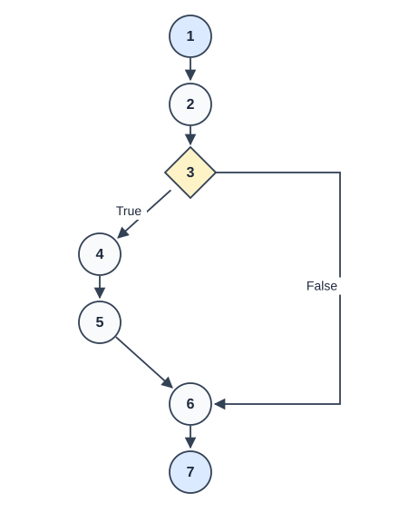
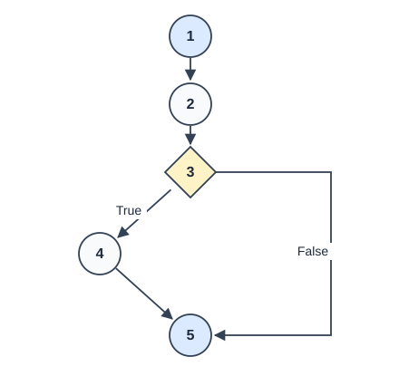
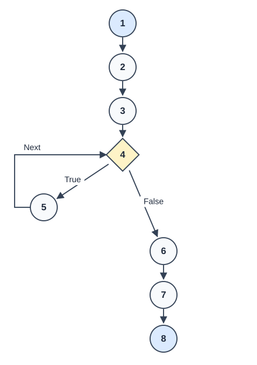
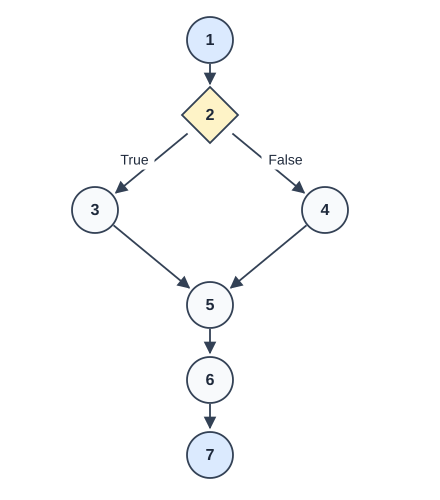
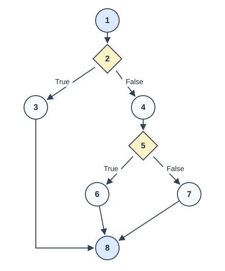
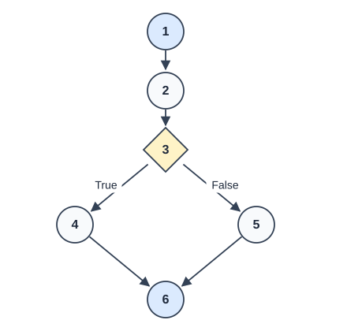
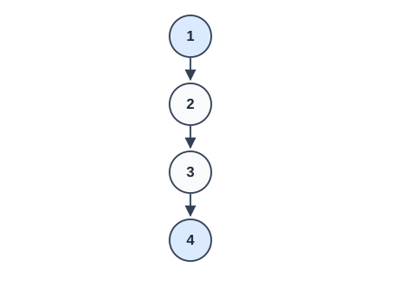
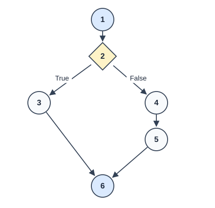

# Week 2 - White-Box Testing and Coverage

| Item | Value |
| --- | --- |
| Course | TEB3433 / TFB3433 - Software Testing and Quality Assurance, September 2026 |
| Lab group | Wednesday Lab - Group 2 |
| Phase owner | Darius Lee Shin |
| Execution date | 26 October 2026 (UTC+08:00) |
| Environment | macOS; Python 3.14.7; Flask 3.0.3; pytest 9.1.1; pytest-cov 7.1.0; coverage.py 7.16.2 |
| Source under test | `app.py`, `helpers.py` (repository root, unchanged) |

## Deliverable checklist

- [x] [1. Selected code units and justification](#1-selected-code-units-and-justification)
- [x] [2. Control-flow analysis](#2-control-flow-analysis)
- [x] [3. White-box test cases](#3-white-box-test-cases) - 28 cases in [test_cases.md](test_cases.md)
- [x] [4. Automated/unit test files](#4-automated-test-implementation) - [test_app.py](test_app.py), [test_helpers.py](test_helpers.py)
- [x] [5. Coverage report and interpretation](#5-coverage-results-and-interpretation) - [HTML report](htmlcov/index.html)

## 1. Selected code units and justification

Eight backend functions in `app.py` were selected for their role in data integrity, resource management and access control. Each has bounded decisions that support an explicit control-flow graph (CFG). A unit test isolates a callable with mocks; an integration test uses real Flask or SQLite.

| Code unit | Responsibility and justification | Logic or risk examined | Test approach |
| --- | --- | --- | --- |
| `get_db` | Gets the request's database connection; every persistent operation depends on it | Create versus reuse; context storage; named-row access | Integration with temporary SQLite and a Flask app context |
| `close_connection` | Releases the connection at teardown | Connection present versus absent; closure when an exception is passed | Unit tests with a mock connection, plus real teardown |
| `init_db` | Creates tables and default categories | Zero and non-zero loop iterations; commit; repeat runs keep data | Integration with temporary SQLite, including an empty category list |
| `row_to_task` | Converts a database row into the task shown to users | Done versus open; conditional urgency; Boolean conversion | Unit tests with a dictionary row and mocked urgency |
| `get_category_name` | Resolves a category id to its name | Falsy id bypass; found; not found | Unit test for the bypass; SQLite integration for lookups |
| `get_category_id_by_name` | Resolves a category name to its id | Found versus absent; parameterised query with unrecognised input | Integration with seeded categories |
| `login_required_web` | Protects web views | Missing session id; HTTP 302; argument forwarding; metadata | Unit tests with request contexts; integration with `/` |
| `login_required_api` | Protects API views | JSON error with HTTP 401; argument forwarding; metadata | Unit tests with request contexts; integration with `/api/tasks` |

The four pure functions in `helpers.py` (`compute_urgency`, `is_valid_password`, `is_valid_username`, `completed_in_last_n_days`) are tested by a separate helper suite and included in the coverage measurement. Registration, login, task CRUD and dashboard routes are outside the selected scope.

## 2. Control-flow analysis

Pseudocode follows Dalbey's structured-English standard [1]. Each numbered action is a CFG node; diamonds are decisions with labelled True/False edges. Library calls are treated as single operations, and exception edges inside Flask, SQLite and library code are excluded, so complexity refers to normal flow. Each decorator has two CFGs: building the wrapper, and calling it.

### 2.1 `get_db`

| Pseudocode | Control-flow graph |
| --- | --- |
| <pre>[1] PROCEDURE get_db [2]     SET database TO context connection, or NONE [3]     IF database is NONE THEN [4]         CALL open SQLite connection and store in context [5]         SET row factory TO named-row access         ENDIF [6]     RETURN database [7] ENDPROCEDURE</pre> |  |

True creates a connection; False reuses the one already in the context.

### 2.2 `close_connection`

| Pseudocode | Control-flow graph |
| --- | --- |
| <pre>[1] PROCEDURE close_connection(exception) [2]     SET database TO context connection, or NONE [3]     IF database is not NONE THEN [4]         CALL close database connection         ENDIF [5] ENDPROCEDURE</pre> |  |

The `exception` argument is not inspected, so it adds no decision.

### 2.3 `init_db`

| Pseudocode | Control-flow graph |
| --- | --- |
| <pre>[1] PROCEDURE init_db [2]     ENTER application context and CALL get_db [3]     CALL create tables if absent         SET category iterator TO start of default categories [4]     WHILE another default category exists [5]         CALL insert category if absent             ADVANCE category iterator         ENDWHILE [6]     CALL commit database transaction [7]     LEAVE application context [8] ENDPROCEDURE</pre> |  |

The Python `for` loop is shown as a WHILE loop to expose its entry, back edge and exit.

### 2.4 `row_to_task`

| Pseudocode | Control-flow graph |
| --- | --- |
| <pre>[1] PROCEDURE row_to_task(row, category_name) [2]     IF task is not completed THEN [3]         CALL compute_urgency with due date         ELSE [4]         SET urgency TO &quot;Done&quot;         ENDIF [5]     CREATE task mapping from row fields and category         CONVERT completion flag TO Boolean         INCLUDE selected urgency [6]     RETURN task mapping [7] ENDPROCEDURE</pre> |  |

The conditional expression inside the returned dictionary is expanded into a decision.

### 2.5 `get_category_name`

| Pseudocode | Control-flow graph |
| --- | --- |
| <pre>[1] PROCEDURE get_category_name(database, category_id) [2]     IF category_id is missing or falsy THEN [3]         RETURN NONE         ELSE [4]         CALL fetch category by parameterised identifier [5]         IF a matching row exists THEN [6]             RETURN category name             ELSE [7]             RETURN NONE             ENDIF         ENDIF [8] ENDPROCEDURE</pre> |  |

A missing id bypasses the database; a supplied id may still find no row.

### 2.6 `get_category_id_by_name`

| Pseudocode | Control-flow graph |
| --- | --- |
| <pre>[1] PROCEDURE get_category_id_by_name(database, name) [2]     CALL fetch category by parameterised name [3]     IF a matching row exists THEN [4]         RETURN category identifier         ELSE [5]         RETURN NONE         ENDIF [6] ENDPROCEDURE</pre> |  |

### 2.7 `login_required_web` - decorator construction

| Pseudocode | Control-flow graph |
| --- | --- |
| <pre>[1] PROCEDURE login_required_web(protected_function) [2]     DEFINE wrapper accepting positional and named arguments         PRESERVE protected function metadata [3]     RETURN wrapper [4] ENDPROCEDURE</pre> |  |

### 2.8 `login_required_web` - wrapper invocation

| Pseudocode | Control-flow graph |
| --- | --- |
| <pre>[1] PROCEDURE wrapper(arguments, named_arguments) [2]     IF session user identifier is missing or falsy THEN [3]         RETURN redirect response to login page (HTTP 302)         ELSE [4]         CALL protected_function with all arguments [5]         RETURN protected function result         ENDIF [6] ENDPROCEDURE</pre> |  |

### 2.9 `login_required_api` - decorator construction

| Pseudocode | Control-flow graph |
| --- | --- |
| <pre>[1] PROCEDURE login_required_api(protected_function) [2]     DEFINE wrapper accepting positional and named arguments         PRESERVE protected function metadata [3]     RETURN wrapper [4] ENDPROCEDURE</pre> |  |

### 2.10 `login_required_api` - wrapper invocation

| Pseudocode | Control-flow graph |
| --- | --- |
| <pre>[1] PROCEDURE wrapper(arguments, named_arguments) [2]     IF session user identifier is missing or falsy THEN [3]         RETURN authentication error JSON and HTTP 401         ELSE [4]         CALL protected_function with all arguments [5]         RETURN protected function result         ENDIF [6] ENDPROCEDURE</pre> |  |

## 3. White-box test cases

### 3.1 Cyclomatic complexity and coverage criterion

For a connected CFG with one entry and one exit, $V(G) = E - N + 2$ [4], where $E$ is edges and $N$ is nodes.

| Graph | N | E | Calculation | Basis paths |
| --- | ---: | ---: | --- | ---: |
| `get_db` | 7 | 7 | 7 − 7 + 2 | 2 |
| `close_connection` | 5 | 5 | 5 − 5 + 2 | 2 |
| `init_db` | 8 | 8 | 8 − 8 + 2 | 2 |
| `row_to_task` | 7 | 7 | 7 − 7 + 2 | 2 |
| `get_category_name` | 8 | 9 | 9 − 8 + 2 | 3 |
| `get_category_id_by_name` | 6 | 6 | 6 − 6 + 2 | 2 |
| `login_required_web` construction | 4 | 3 | 3 − 4 + 2 | 1 |
| `login_required_web` wrapper | 6 | 6 | 6 − 6 + 2 | 2 |
| `login_required_api` construction | 4 | 3 | 3 − 4 + 2 | 1 |
| `login_required_api` wrapper | 6 | 6 | 6 − 6 + 2 | 2 |
| **Total** | | | | **19** |

Criterion: **100% statement coverage and every basis path of the selected functions.** This is not exhaustive path coverage: `init_db`'s loop can run any number of times. Zero and four iterations form its basis; zero iterations needs a test-only empty category list because production always has four.

### 3.2 Independent execution paths

| Graph | Path ID | Node sequence | Test case |
| --- | --- | --- | --- |
| `get_db` | DB01 | 1-2-3-4-5-6-7 | TC-WB-001 |
| `get_db` | DB02 | 1-2-3-6-7 | TC-WB-002 |
| `close_connection` | CL01 | 1-2-3-4-5 | TC-WB-003 |
| `close_connection` | CL02 | 1-2-3-5 | TC-WB-004 |
| `init_db` | IN01 | 1-2-3-4-6-7-8 | TC-WB-005 |
| `init_db` | IN02 | 1-2-3-(4-5)×4-4-6-7-8 | TC-WB-006 |
| `row_to_task` | RT01 | 1-2-3-5-6-7 | TC-WB-007 |
| `row_to_task` | RT02 | 1-2-4-5-6-7 | TC-WB-008 |
| `get_category_name` | CN01 | 1-2-3-8 | TC-WB-009 |
| `get_category_name` | CN02 | 1-2-4-5-6-8 | TC-WB-010 |
| `get_category_name` | CN03 | 1-2-4-5-7-8 | TC-WB-011 |
| `get_category_id_by_name` | CI01 | 1-2-3-4-6 | TC-WB-012 |
| `get_category_id_by_name` | CI02 | 1-2-3-5-6 | TC-WB-013 |
| `login_required_web` construction | WF01 | 1-2-3-4 | TC-WB-014 |
| `login_required_web` wrapper | WA01 | 1-2-3-6 | TC-WB-015 |
| `login_required_web` wrapper | WA02 | 1-2-4-5-6 | TC-WB-016 |
| `login_required_api` construction | AF01 | 1-2-3-4 | TC-WB-017 |
| `login_required_api` wrapper | AA01 | 1-2-3-6 | TC-WB-018 |
| `login_required_api` wrapper | AA02 | 1-2-4-5-6 | TC-WB-019 |

Together the 19 paths visit every node and edge of each CFG. pytest-cov measures statements, not named paths, so path coverage is shown by this mapping.

### 3.3 Test cases

All 28 cases, with preconditions, data, expected and actual results, are in [test_cases.md](test_cases.md): 19 basis-path cases, 5 supplementary integration cases (real teardown, new context, repeat initialisation, rejected and accepted endpoint sessions) and 4 helper suites.

### 3.4 Path and data-flow considerations

- **Data flow:** the session `user_id` is defined at login and used only by the two wrappers (TC-WB-015/016, 018/019). Its value is trusted, not re-validated, so session forgery is not detected here (tested in Week 5, DEF-028).
- **Loop paths:** `init_db` is covered at 0 and 4 iterations only.
- **Helper specification gaps:** the helper suite records current behaviour, including two known mismatches. The today case expects `Overdue` although the docstring says `Due Today` (DEF-002), and the exact 8-character password boundary is not tested; the code uses `> 8` (DEF-001). `completed_in_last_n_days` uses `age.days < n`, while its docstring describes an inclusive limit, and its boundary test uses 4 days with n = 5. Requirements-based tests for the password and due-today boundaries were added in Week 6 (`test_05_rules_unit.py`).

## 4. Automated test implementation

| Script / group | Test definitions | Collected instances | Approach | Result |
| --- | ---: | ---: | --- | --- |
| `test_helpers.py` | 20 | 20 | Pure-function unit tests | 20 passed |
| `test_app.py` - `unit` marker | 8 | 20 | Mocks, query bypass, conversion, decorators | 20 passed |
| `test_app.py` - `integration` marker | 10 | 10 | Temporary SQLite and Flask client/context | 10 passed |
| **Combined** | **38** | **50** | | **50 passed, no warnings** |

Parameterisation turns 38 definitions into 50 instances, so the number of tests is not the number of paths: 19 basis paths are implemented as 30 backend instances, some repeating a path with different inputs.

| Backend group | Marker | Definitions | Instances | Paths covered |
| --- | --- | ---: | ---: | --- |
| Connection cleanup | unit | 3 | 3 | CL01, CL02 |
| Missing category id | unit | 1 | 3 | CN01 × 3 inputs |
| Task conversion | unit | 1 | 4 | RT01, RT02 × 2 categories |
| Unauthenticated decorators | unit | 1 | 6 | WA01, AA01 × 3 session states |
| Authenticated decorators | unit | 1 | 2 | WA02, AA02 |
| Decorator metadata | unit | 1 | 2 | WF01, AF01 |
| Connection lifecycle | integration | 3 | 3 | DB01, DB02 + 2 supplementary |
| Database initialisation | integration | 3 | 3 | IN01, IN02 + 1 supplementary |
| Category lookups | integration | 2 | 2 | CN02, CN03, CI01, CI02 |
| Endpoint authentication | integration | 2 | 2 | Supplementary (WA/AA through real routes) |
| **Backend total** | | **18** | **30** | **19 paths** |

**Isolation:** the `flask_app` fixture points `app.DATABASE` at a per-test temporary file and sets testing mode; `initialized_app` seeds it; `monkeypatch` restores settings. No live server is started and `pytodo_pro.db` is never written.

## 5. Coverage results and interpretation

### 5.1 Whole-module statement coverage

| Source module | Statements | Executed | Missed | Coverage |
| --- | ---: | ---: | ---: | ---: |
| `helpers.py` | 31 | 31 | 0 | 100.00% |
| `app.py` | 299 | 136 | 163 | 45.48% |
| Overall | 330 | 167 | 163 | 50.61% |

`app.py` is lower because pytest-cov measures the whole file. The missed statements are outside the selected scope: registration (lines 140-160), login (165-176), task and dashboard routes, and the startup block. 45% is the whole-file figure, not coverage of the eight selected functions. No lines were excluded to raise the score.

### 5.2 Selected backend functions

| Callable | Statements | Executed | Missed | Coverage |
| --- | ---: | ---: | ---: | ---: |
| `get_db` | 5 | 5 | 0 | 100% |
| `close_connection` | 3 | 3 | 0 | 100% |
| `init_db` | 6 | 6 | 0 | 100% |
| `row_to_task` | 1 | 1 | 0 | 100% |
| `get_category_name` | 4 | 4 | 0 | 100% |
| `get_category_id_by_name` | 2 | 2 | 0 | 100% |
| `login_required_web` - factory | 2 | 2 | 0 | 100% |
| `login_required_web.wrapper` | 3 | 3 | 0 | 100% |
| `login_required_api` - factory | 2 | 2 | 0 | 100% |
| `login_required_api.wrapper` | 3 | 3 | 0 | 100% |
| **Total** | **31** | **31** | **0** | **100%** |

`row_to_task` counts as one statement (a multi-line return) even though it holds a decision; both outcomes were tested separately (RT01, RT02). This is why statement percentages cannot replace the CFG analysis.

### 5.3 Interpretation and limitations

- Every basis path of the selected functions has a passing test, and their statements are 100% covered. This is basis-path coverage of the stated models, not exhaustive path coverage.
- 100% statement coverage of `helpers.py` does not mean the helpers meet their specification: the suite passes while encoding DEF-001 and DEF-002.
- The decorator tests show the session check works, not that authentication is secure: the session id is trusted, and password checking is not tested here.
- Database failures, concurrency and malformed rows are not covered.
- Routes outside the selected scope are exercised by the Week 4 API suite and the Week 6 regression suite.

## References

1. Dalbey, J. *Pseudocode Standard*. California Polytechnic State University. https://users.csc.calpoly.edu/~jdalbey/SWE/pdl_std.html
2. Coverage.py. *Branch coverage measurement*. https://coverage.readthedocs.io/en/latest/branch.html
3. pytest-cov. *Reporting* and *Configuration*. https://pytest-cov.readthedocs.io/en/latest/reporting.html
4. McCabe, T. J. (1976). A complexity measure. *IEEE Transactions on Software Engineering, SE-2*(4), 308-320. https://doi.org/10.1109/TSE.1976.233837
