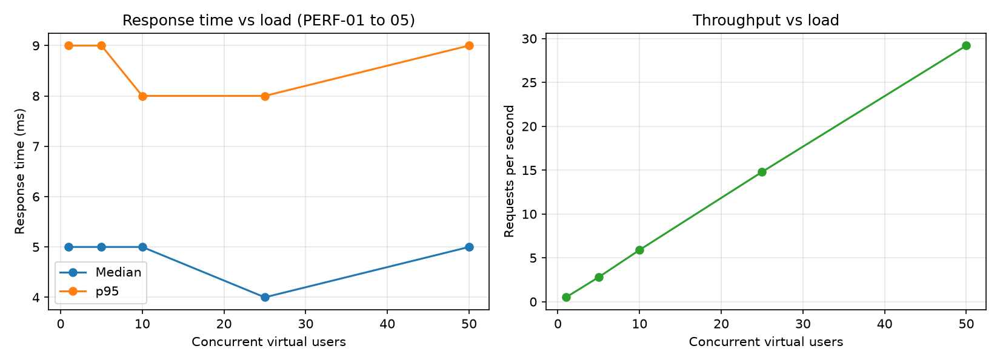
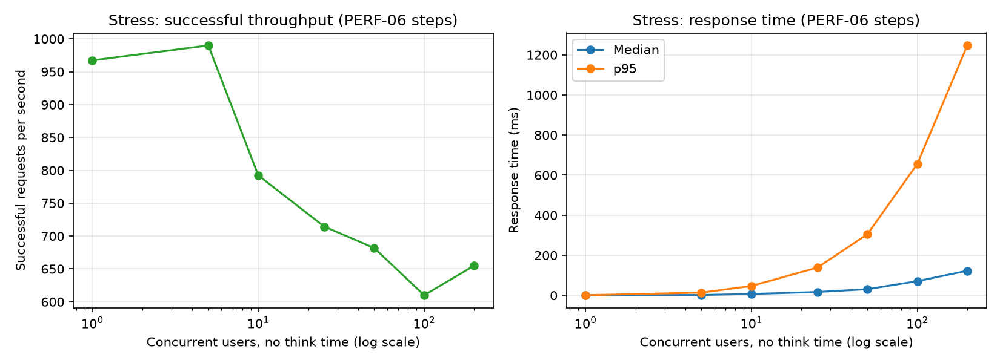
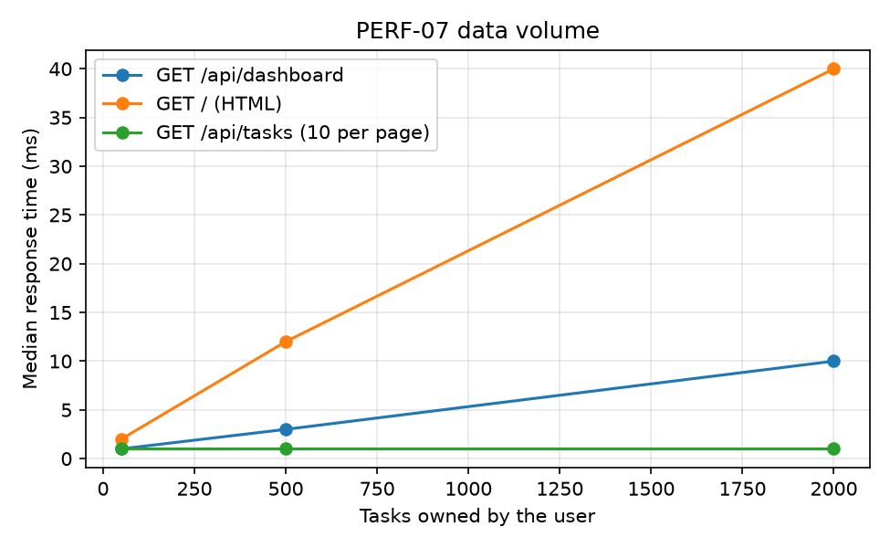

# Week 5 - Security and Performance Testing

| Item | Value |
| --- | --- |
| Course | TEB3433 / TFB3433 - Software Testing and Quality Assurance, September 2026 |
| Lab group | Wednesday Lab - Group 2 |
| Phase owner | Wan Haziqah Binti Wan Hanafi |
| Security tests (SEC-01 to 24) | 2026-11-25, run by Wan Haziqah Binti Wan Hanafi on a desktop PC: AMD Ryzen 5 5500 (6 cores, 3.6 GHz), 32 GB RAM, Windows 64-bit; Python 3.12.10, Flask 3.1.3, pytest 9.2.0 |
| Performance tests (PERF-01 to 07) | 2026-11-27, run on Darius Lee Shin's MacBook Air: Apple M4 (10 cores), 24 GB RAM, macOS 26.5.2; Python 3.14.7, Flask 3.0.3, Werkzeug 3.1.9; Apache JMeter 5.6.3 on OpenJDK 21 |
| Build under test | `app.py`, `helpers.py`, `templates/` from the repository root, unchanged; fresh SQLite database |

## Deliverable checklist

- [x] [Threat/STRIDE table](#3-stride-threat-table) - 22 threats
- [x] [Security test cases and findings](#4-security-test-cases-and-findings) - 24 cases in [test_cases.md](test_cases.md); DEF-024 to DEF-036 in [defects.md](defects.md)
- [x] [Performance test objective and workload](#5-performance-test-design) - JMeter plans in [jmeter/](jmeter/)
- [x] [Performance results and interpretation](#6-performance-results-and-interpretation) - PERF-01 to 07; DEF-037
- [x] [Security/performance limitations and recommendations](#7-limitations) - sections 7 and 8

## 1. Summary

| | |
| --- | --- |
| Security cases | 24 (21 automated in `test_security.py`, 1 manual, 2 tool scans): **6 Pass, 18 Fail** |
| New defects | **14** (DEF-024 to DEF-037): 2 Critical, 1 Major, 6 Moderate, 5 Minor |
| Earlier defects re-tested | DEF-005 (upgraded to Major: stored XSS), DEF-014, DEF-015, DEF-017, DEF-023 |
| Load (1-50 users, 1-3 s think time) | **Target met at every step**: 0 errors, median 4-5 ms, p95 ≤ 9 ms |
| Stress (no think time) | Throughput saturates at **about 790 req/s from 10 users**; p95 passes 1,000 ms **between 100 and 200 users**; no server errors up to 200 users |
| Data volume | Home page **20× slower** (2 → 40 ms) as one user's tasks grow from 50 to 2,000 (DEF-037) |

The two most serious findings are **Critical**: the API search builds SQL from user input, so one crafted search returns every user's tasks (DEF-029), and the hard-coded secret key lets anyone who reads the source sign a session cookie for any user (DEF-028).

What held up: passwords are hashed with scrypt; login is not injectable; login errors do not reveal valid usernames; reading or editing another user's task through the API is refused.

## 2. Scope and rules of engagement

| Item | Decision |
| --- | --- |
| In scope | Authentication and sessions, task ownership, input handling (search, titles, dates, paging), error handling, HTTP headers, dependencies, response time under load |
| Out of scope | Network/OS attacks, password cracking, large-scale fuzzing, anything not on our own machine |
| Target | `127.0.0.1` only; the security scripts refuse any other host |
| Data | Throwaway accounts only (`sec_user_a`, `sec_user_b`, `perf_user_1..20`, `volume_user`, random `u_...`) |
| Safety rule | Payloads only detect a weakness. No data was dumped, no hashes cracked, and the Werkzeug debugger console was not used. No uncontrolled penetration testing. |

## 3. STRIDE threat table

**Model.** A browser talks to the Flask app (web pages and the `/api` JSON endpoints), which stores everything in one SQLite file. The trust boundary is between the browser and the server: everything the browser sends is untrusted. There is no admin role, so elevation of privilege means one user acting on another user's data.

| Asset | Why it matters | Entry points |
| --- | --- | --- |
| A1 User accounts and passwords | Takeover exposes all of a user's tasks | `/register`, `/login`, `/api/register`, `/api/login` |
| A2 Session cookie | Holding it = being logged in | Every authenticated request |
| A3 Task data | Private per user; integrity matters | `/tasks/new`, `/tasks/<id>/edit`, `/toggle`, `/delete`, `/api/tasks`, `/api/tasks/<id>` |
| A4 Dashboard and search | Must reflect only the user's own tasks | `/`, `/dashboard`, `/api/dashboard`, `/api/tasks?q=` |
| A5 Availability | One bad request or heavy load should not take the app down | All endpoints |
| A6 Database file, source, secret key | Hold every user's data and the session-signing key | Error pages, `app.py` |

| ID | STRIDE | Asset | Threat | Control observed in code | Risk | Tests | Outcome |
| --- | --- | --- | --- | --- | --- | --- | --- |
| TH-01 | Spoofing | A1 | Username enumeration from login errors | Same message for both cases | Low | SEC-01 | Mitigated |
| TH-02 | Spoofing | A1 | Unlimited password guessing | None | High | SEC-02 | **DEF-024** |
| TH-03 | Spoofing | A1 | Weak, common passwords | Length only | Medium | SEC-06 | **DEF-027** |
| TH-04 | Spoofing | A2 | Stolen cookie still valid after logout | Client-side signed cookie; logout clears only the browser copy | Medium | SEC-04, SEC-05 | **DEF-025, DEF-026** |
| TH-05 | Spoofing | A2, A6 | Forged session cookie signed with the hard-coded key | `SECRET_KEY = "pytodo-pro-dev-secret"` (app.py line 28) | **Critical** | SEC-20 | **DEF-028** |
| TH-06 | Tampering | A3, A4 | SQL injection in API search | f-string `title LIKE '%{q}%'` in `api_list_tasks` | **Critical** | SEC-07a, SEC-07b | **DEF-017, DEF-029** |
| TH-07 | Tampering | A1 | SQL injection in login | Parameterised query | High | SEC-08 | Mitigated |
| TH-08 | Tampering | A3 | Cross-site request forgery | No CSRF tokens; no Origin check | Medium | SEC-09a, SEC-09b | **DEF-030** |
| TH-09 | Tampering | A3 | Mass assignment of `user_id` | Owner always taken from session | Medium | SEC-10 | Mitigated |
| TH-10 | Repudiation | A3 | No record of who logged in or deleted what | Access log only, no user | Low | SEC-11 | **DEF-035** |
| TH-11 | Information disclosure | A3 | Stored XSS through task title | `{{ t.title\|safe }}` (index.html line 44) | High | SEC-12 | **DEF-005** (upgraded) |
| TH-12 | Information disclosure | A6 | Tracebacks and Werkzeug debugger on errors | `app.run(debug=True)` | High | SEC-13, SEC-23 | **DEF-031** |
| TH-13 | Information disclosure | A3 | Reading another user's task by id | `WHERE id = ? AND user_id = ?` | Medium | SEC-15 | Mitigated |
| TH-14 | Information disclosure | A1 | Plain-text passwords | Werkzeug scrypt hashing | High | SEC-21 | Mitigated |
| TH-15 | Information disclosure | A3 | Clickjacking / MIME sniffing | No security headers | Low | SEC-14 | **DEF-032** |
| TH-16 | Information disclosure | A3 | Vulnerable dependency | Flask 3.0.3 pinned | Low | SEC-22 | **DEF-036** |
| TH-17 | Denial of service | A5 | Huge payloads stored and rendered | No length limit | Medium | SEC-16 | **DEF-033** |
| TH-18 | Denial of service | A5 | Unbounded page size | `per_page` used as-is in `LIMIT` | Medium | SEC-17 | **DEF-034** |
| TH-19 | Denial of service | A3, A5 | One bad date breaks all of a user's pages | No date validation | High | SEC-24 | **DEF-015** |
| TH-20 | Denial of service | A5 | Slowdown or errors under concurrent use | Dev server + SQLite | Medium | PERF-01 to 07 | Section 6; **DEF-037** |
| TH-21 | Elevation of privilege | A3 | Deleting another user's task via the API | `DELETE ... WHERE id = ?` only | **Critical** | SEC-18 | **DEF-014** |
| TH-22 | Elevation of privilege | A3 | Editing another user's task via the API | Ownership checked | High | SEC-19 | Mitigated |

## 4. Security test cases and findings

Full cases: [test_cases.md](test_cases.md). Raw results: [security_run_raw.txt](evidences/security/security_run_raw.txt) (every finding shown as FAILED) and [security_run.txt](evidences/security/security_run.txt) (regression view: confirmed defects as XFAIL with their IDs).

| Test ID | Threat | Type | Test data / action | Expected | Actual | Status | Defect |
| --- | --- | --- | --- | --- | --- | --- | --- |
| SEC-01 | TH-01 | Auto | Login with unknown user vs known user + wrong password | Identical response | Same 401 / same web message | Pass | |
| SEC-02 | TH-02 | Auto | 20 wrong passwords, then the correct one | 429 or lockout after N failures | All 20 return 401 at once; correct password then 200 | Fail | DEF-024 |
| SEC-03 | TH-04 | Auto | 7 API calls with no cookie | 401 for all | 6 × 401; `GET /api/categories` 200 | Fail | DEF-023 |
| SEC-04 | TH-04 | Auto | Inspect `Set-Cookie` from `/api/login` | `HttpOnly` and `SameSite` | `HttpOnly`, no `SameSite` | Fail | DEF-025 |
| SEC-05 | TH-04 | Auto | Copy cookie, `/logout`, replay it | 401 | 200 with the task list | Fail | DEF-026 |
| SEC-06 | TH-03 | Auto | Register with password `password123` | 400 | 201 | Fail | DEF-027 |
| SEC-07a | TH-06 | Auto | `GET /api/tasks?q=O'Brien` | 200 | 500 | Fail | DEF-017 |
| SEC-07b | TH-06 | Auto | As A, search `%' OR user_id != 0 OR title LIKE '` | Only A's tasks | B's task (and every other user's) returned | Fail | DEF-029 |
| SEC-08 | TH-07 | Auto | Username `sec_user_a' --`, any password | 401 | 401 | Pass | |
| SEC-09a | TH-08 | Auto | Parse POST forms on `/` and `/login` | CSRF token in each | 0 of 5 forms have one | Fail | DEF-030 |
| SEC-09b | TH-08 | Auto | POST `/tasks/<id>/delete` with `Origin: http://evil.example` | Refused | Task deleted | Fail | DEF-030 |
| SEC-10 | TH-09 | Auto | `POST /api/tasks` with `"user_id": <B>` as A | Task stays A's | Created for A only | Pass | |
| SEC-11 | TH-10 | Manual | Log in, fail a login, delete a task; read the console | Event, user and time logged | Request line only; no username or failed-login record | Fail | DEF-035 |
| SEC-12 | TH-11 | Auto | Title ``, load `/` | Escaped text | Raw tag in HTML; script runs | Fail | DEF-005 |
| SEC-13 | TH-12 | Auto | `GET /api/tasks?q='` | Generic 500 | Traceback, SQL error, file paths, Werkzeug debugger | Fail | DEF-031 |
| SEC-14 | TH-15 | Auto | Response headers on `/` | XCTO, XFO, CSP | None | Fail | DEF-032 |
| SEC-15 | TH-13 | Auto | B `GET /api/tasks/<A's id>` | 404 | 404 | Pass | |
| SEC-16 | TH-17 | Auto | 100,000-character title | 400/413/422 | 201 | Fail | DEF-033 |
| SEC-17 | TH-18 | Auto | `per_page=1000000`, `per_page=-1` | Capped or 400 | 200; `-1` returns all tasks | Fail | DEF-034 |
| SEC-18 | TH-21 | Auto | B `DELETE /api/tasks/<A's id>` | 403/404, task kept | 200; task gone | Fail | DEF-014 |
| SEC-19 | TH-22 | Auto | B `PUT /api/tasks/<A's id>` | Unchanged | 404; unchanged | Pass | |
| SEC-20 | TH-05 | Auto | Sign `{"user_id": A}` with the key from app.py; call `/api/tasks` | 401 | 200 with A's private task | Fail | DEF-028 |
| SEC-21 | TH-14 | Auto | Read `users.password_hash` | Hashed | `scrypt:32768:8:1$...` for all users | Pass | |
| SEC-22 | TH-16 | Tool | `pip-audit -r requirements.txt` | No known CVEs | Flask 3.0.3: CVE-2026-27205 (fixed in 3.1.3) | Fail | DEF-036 |
| SEC-23 | All | Tool | `bandit -r` on the app | No High issues | 1 High (B201 `debug=True`), 1 Low (B105 hard-coded key) | Fail | DEF-031, DEF-028 |
| SEC-24 | TH-19 | Re-test | Create task with `due_date: "31/12/2026"`, then `/api/dashboard` | 400, then 200 | 500 (task saved anyway); dashboard 500 | Fail | DEF-015 |

**Tool limitation.** bandit did not flag the SQL injection (DEF-029), because the f-string is built on a separate line before `execute()`. A clean static scan is not proof of safety; code review and the targeted test found it.

## 5. Performance test design

### 5.1 Objective

Measure response time, throughput and error rate on PyTodo Pro's busiest endpoints as concurrent users increase (load), find the point where the server saturates and misses the response-time target (stress), and check how response time grows with a user's data (volume).

### 5.2 Busy pages and endpoints selected

| Endpoint | Why chosen | Weight |
| --- | --- | --- |
| `GET /api/tasks` | Most frequent read; behind the task list | 4 |
| `GET /api/dashboard` | Loads **all** of a user's tasks and computes urgency per row | 3 |
| `GET /` (HTML) | Template rendering plus one category query **per task** (N+1), no paging | 2 |
| `GET /api/tasks?q=` | `LIKE '%...%'` cannot use an index | 2 |
| `POST` -> `PUT` -> `DELETE /api/tasks/<id>` | Writes; SQLite allows one writer at a time | 1 |
| `POST /api/login` | Once per virtual user; scrypt hashing is deliberately slow | once |

### 5.3 Workload (defined before execution)

| Setting | Value |
| --- | --- |
| Tool | Apache JMeter 5.6.3, non-GUI mode; plans [pytodo_load.jmx](jmeter/pytodo_load.jmx) and [pytodo_data_volume.jmx](jmeter/pytodo_data_volume.jmx); runner [run_performance.py](jmeter/run_performance.py) |
| Test data | setUp Thread Group registers `perf_user_1..20` with 50 tasks each; each virtual user logs in once as one of them |
| Virtual user loop | Think time, then one weighted action (list 4 : dashboard 3 : home 2 : search 2 : write cycle 1) chosen by a Switch Controller |
| Think time | Uniform random 1-3 s (load); none (stress) |
| PERF-01 to 05 (load) | 1, 5, 10, 25, 50 users; ramp-up users ÷ 5 s; **120 s measured after ramp-up** |
| PERF-06 (stepped stress) | 1, 5, 10, 25, 50, 100, 200 users, no think time; 5 s ramp-up, **10 s measured**, 35 s pause between steps |
| PERF-06b (sustained stress) | 50 users, no think time, 90 s measured |
| PERF-07 (data volume) | One user with 50, 500 or 2,000 tasks; 30 sequential requests each to the dashboard API, the home page and the paged API |
| Assertions | Status code per request (200, or 201 for create); home page must contain `My Tasks` |
| Isolation | Fresh server and empty database per test; port 5015 (macOS reserves 5000); unchanged app started by [run_perf_server.py](jmeter/run_perf_server.py) with `debug=True`, threaded, reloader off |
| Targets (set before the run) | Median < 200 ms, p95 < 1,000 ms, errors < 1% |

Stress steps are short because the app closes every connection after one response (`Connection: close`), so each request uses a new client port. macOS has 16,384 such ports and holds each for 30 s after closing, about 546 new connections per second. Each 10 s step stays within that limit; a longer run does not (PERF-06b).

### 5.4 Environment

| Item | Value |
| --- | --- |
| Machine | MacBook Air, Apple M4 (10 cores: 4 performance, 6 efficiency), 24 GB RAM |
| OS | macOS 26.5.2 (arm64) |
| Software | Python 3.14.7, Flask 3.0.3 (as pinned in `requirements.txt`), Werkzeug 3.1.9, JMeter 5.6.3, OpenJDK 21.0.13 |
| Server | Flask built-in server, threaded, `debug=True`, 127.0.0.1:5015 |
| Load generator | JMeter on the **same** machine |
| Run times | 2026-11-27 15:40-15:54 (PERF-01 to 05, 06b, 07) and 16:07-16:14 (PERF-06), UTC+08:00 |
| Evidence | [evidences/performance/20261127-mac/](evidences/performance/20261127-mac/): `perf_summary.md`, `perf_summary.csv`, charts, `run.json`, raw results `*.jtl.gz`, server logs, JMeter HTML dashboards for PERF-05, PERF-06b and the 200-user stress step |

## 6. Performance results and interpretation

### 6.1 Load test (PERF-01 to 05)

| Test | Users | Requests | Throughput (req/s) | Median (ms) | p95 (ms) | p99 (ms) | Max (ms) | Errors | Meets target |
| --- | ---: | ---: | ---: | ---: | ---: | ---: | ---: | ---: | --- |
| PERF-01 | 1 | 65 | 0.5 | 5 | 9 | 23 | 23 | 0% | Yes |
| PERF-02 | 5 | 340 | 2.8 | 5 | 9 | 12 | 23 | 0% | Yes |
| PERF-03 | 10 | 705 | 5.9 | 5 | 8 | 11 | 51 | 0% | Yes |
| PERF-04 | 25 | 1,770 | 14.8 | 4 | 8 | 11 | 34 | 0% | Yes |
| PERF-05 | 50 | 3,500 | 29.2 | 5 | 9 | 13 | 31 | 0% | Yes |

The home page was the slowest endpoint at every step (median 7-9 ms, p95 10-23 ms); the API endpoints had medians of 4-7 ms. Per-endpoint figures: [perf_summary.md](evidences/performance/20261127-mac/perf_summary.md).

### 6.2 Stress test (PERF-06, stepped)

| Users (no think time) | Requests | Successful req/s | Median (ms) | p95 (ms) | p99 (ms) | Max (ms) | Errors | Home page p95 (ms) | Meets target |
| ---: | ---: | ---: | ---: | ---: | ---: | ---: | --- | ---: | --- |
| 1 | 16,658 | 967 (a) | 1 | 1 | 2 | 16 | 41.9% client (a) | 2 | No (client) |
| 5 | 12,382 | 990 (a) | 2 | 14 | 24 | 165 | 20.1% client (a) | 25 | No (client) |
| 10 | 7,923 | **792** | 7 | 47 | 72 | 202 | 0% | 77 | Yes |
| 25 | 7,144 | 714 | 17 | 139 | 218 | 367 | 0% | 227 | Yes |
| 50 | 6,818 | 682 | 31 | 305 | 457 | 815 | 0% | 473 | Yes |
| 100 | 6,100 | 610 | 71 | 656 | 1,007 | 1,984 | 0% | **1,019** | Yes (overall) |
| 200 | 6,550 | 655 | 123 | **1,247** | 1,902 | 3,168 | 0% | 1,915 | **No** |

(a) At 1 and 5 users each response took about 1 ms, so JMeter opened connections faster than macOS frees ports and part of the step failed on the client (`java.net.BindException`). The successful rate is a lower bound for these two steps.

**PERF-06b (sustained, 50 users, 90 s):** no errors for the first 22 s (about 686 req/s, median 31 ms, p95 303 ms, matching the 50-user step). After that, JMeter ran out of client ports and 65.4% of requests failed with `BindException`, while 51,489 requests (572 per second) succeeded. The server logged no HTTP 500s. This run measures the test machine's port limit, not the app, and is recorded as Blocked.

### 6.3 Data volume (PERF-07)

| Tasks owned by the user | `GET /api/dashboard` median / p95 (ms) | `GET /` median / p95 (ms) | `GET /api/tasks` (10 per page) median / p95 (ms) |
| ---: | --- | --- | --- |
| 50 | 1 / 1 | 2 / 4 | 1 / 1 |
| 500 | 3 / 4 | 12 / 16 | 1 / 10 |
| 2,000 | 10 / 12 | **40 / 53** | 1 / 1 |

### 6.4 Findings

| Question | Result | Evidence |
| --- | --- | --- |
| Highest load handled (load test) | **Not reached.** At 50 users (29.2 req/s) there were no errors and p95 stayed at 8-9 ms. Throughput grew in line with users (about 0.58 req/s per user). | PERF-01 to 05 |
| Server saturation point | **About 790 successful req/s, reached at 10 back-to-back users.** More users did not raise throughput (610-714 req/s from 25 to 200 users); they only queued. | PERF-06 |
| Breakpoint against the p95 target | **Between 100 and 200 back-to-back users** (p95 656 ms at 100, 1,247 ms at 200). The home page misses the target first, at 100 users (p95 1,019 ms). | PERF-06 per endpoint |
| Failure mode | **Slows down, does not crash.** No HTTP 500 and no `database is locked` errors up to 200 users; the median rises 7 -> 31 -> 71 -> 123 ms at 10 -> 50 -> 100 -> 200 users. | Server logs |
| Slowest page | `GET /` (HTML): about 2× the API median at normal load and about 8× under stress (246 ms vs 31 ms overall median at 50 users). `index()` has no paging and `row_to_task()` runs one category query per task (N+1). | PERF-06 per endpoint; code |
| Data volume | Home page 2 -> 40 ms (20×) and dashboard 1 -> 10 ms (10×) from 50 to 2,000 tasks; the paged API stays flat. Response time grows linearly with a user's data. | PERF-07; **DEF-037** |
| Connection handling | The dev server sends `Connection: close` on every response, so every request needs a new TCP connection. This, not the app logic, limited the sustained stress run. | PERF-06b; `curl -v` |
| Estimate for real users | About 790 ÷ 0.58 ≈ **1,350 concurrent users** with 1-3 s think time before throughput saturates on this machine. This is an extrapolation, not a measurement. | Calculated |

## 7. Limitations

**Performance**
- JMeter and the app shared one machine, so part of the stress-level latency is the load generator itself.
- Flask's development server with `debug=True` is not a production setup; a WSGI server with several workers and keep-alive would behave differently.
- Each stress step measured only 10 s, so steps show the trend, not long-run stability (memory growth, database size over days). No soak test was run.
- The client port limit (macOS, `Connection: close`) cut the sustained run short and made the 1- and 5-user stress steps lower bounds.
- Localhost only: no network latency. Synthetic users follow a simple weighted loop.
- SQLite allows one writer at a time; a client-server database would behave differently under heavier write loads.

**Security**
- These tests show that a weakness exists, not its full exploitability; passing tests do not prove the app is secure. No penetration testing was done.
- Localhost over HTTP: TLS and the `Secure` cookie flag were not tested.
- The security run used Flask 3.1.3 (installed as a dependency of another tool) while `requirements.txt` pins 3.0.3; none of the findings depend on the difference, and DEF-036 applies to the pinned version.
- Security and performance tests ran on different machines and dates (see the header).

## 8. Recommendations (priority order)

1. **Parameterise the API search** (`title LIKE ?`, as the web route already does). Fixes DEF-029 and DEF-017.
2. **Move `SECRET_KEY` to an environment variable** with a random value. Fixes DEF-028.
3. **Scope API delete to the owner** (`WHERE id = ? AND user_id = ?`). Fixes DEF-014.
4. **Turn off debug mode** outside development. Fixes DEF-031.
5. **Remove `|safe`** from `index.html`. Fixes DEF-005.
6. **Validate input on the server**: date format, title length, `1 ≤ per_page ≤ 100`. Fixes DEF-015, DEF-033, DEF-034.
7. **Add CSRF protection** (Flask-WTF), **login rate limiting** (Flask-Limiter), `SESSION_COOKIE_SAMESITE="Lax"` and security headers. Fixes DEF-030, DEF-024, DEF-025, DEF-032.
8. **Revoke sessions on logout** (server-side session or token version) (DEF-026); **log security events with the username** (DEF-035); **upgrade Flask** to ≥ 3.1.3 (DEF-036).
9. **Performance:** join `categories` in the task query instead of one lookup per task, page the home page, compute dashboard counts in SQL, add an index on `tasks(user_id)`, and run behind Waitress or Gunicorn for keep-alive connections and multiple workers. Addresses DEF-037 and the home-page breakpoint.
