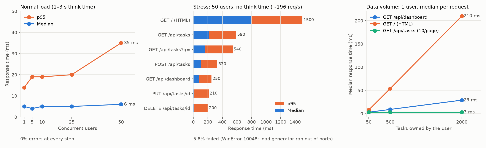

# Week 5: Security and Performance Testing

**Project:** PyTodo Pro QA investigation · TEB3433 STQA · Group 2 · Sept 2026
**Phase owner:** _(your name)_
**Execution date:** 25 Nov 2026
**Build under test:** `pytodo_pro_student` (app.py, helpers.py, templates/), fresh `pytodo_pro.db`

Expected results were written before execution. Raw outputs are in `results/`, screenshots in `evidences/` (index: `evidences/README.md`).

**Test environment (all Week 5 runs):** AMD Ryzen 5 5500 (6 cores, 3.6 GHz), 32 GB RAM, Windows 64-bit · Python 3.12.10 · Flask 3.1.3 / Werkzeug 3.1.9 · pytest 9.2.0 · Locust 2.47.0 · PyTodo run with `python app.py` (dev server, `debug=True`) · load generator on the same machine.

---

## 1. Summary

| | |
|---|---|
| Security test cases | 24 (21 automated in `test_security.py`, 1 manual, 2 tool scans) |
| Passed / Failed | **6 pass / 18 fail** |
| New defects | **14** (DEF-024 to DEF-037): 2 Critical, 1 Major, 6 Moderate, 5 Minor |
| Earlier defects re-confirmed | DEF-005 (upgraded to Major: stored XSS), DEF-014, DEF-015, DEF-017, Week 4 `/api/categories` login defect |
| Performance | **Meets the target at realistic load**: 0% errors and median ≤ 6 ms from 1 to 50 users (p95 ≤ 35 ms). Under stress (no think time) it peaks at **~196 req/s**, median 140 ms, p95 940 ms. The test machine ran out of network ports after ~85 s (5.95% client errors). The home page slows **26×** (8 → 210 ms) as a user's tasks grow from 50 to 2 000 (DEF-037). |

The two most serious findings are both **Critical**:
- **DEF-029:** the API search builds SQL from user input, so one crafted search returns every user's tasks.
- **DEF-028:** the secret key in `app.py` lets anyone who has read the source sign a session cookie for any user and log in without a password.

What held up: passwords are hashed with scrypt; login is not injectable; login errors don't reveal valid usernames; reading or editing another user's task through the API is refused.

---

## 2. Scope and rules of engagement

| Item | Decision |
|---|---|
| In scope | Authentication and sessions, task ownership, input handling (search, titles, dates, paging), error handling, HTTP headers, dependencies, response time under load |
| Out of scope | Network/OS attacks, password cracking, large-scale fuzzing, anything not on our own machine |
| Target | `http://127.0.0.1:5000` only; the scripts refuse any other host |
| Data | Throwaway accounts only (`sec_user_a`, `sec_user_b`, `perf_user_00..19`, random `u_…`) |
| Safety rule | Payloads are used only to detect a weakness. We did not dump data, crack hashes or use the Werkzeug debugger console. |

---

## 3. Assets and entry points

| Asset | Why it matters | Entry points |
|---|---|---|
| A1 User accounts and passwords | Takeover exposes all of a user's tasks | `/register`, `/login`, `/api/register`, `/api/login` |
| A2 Session cookie | Holding it = being logged in | Every authenticated request |
| A3 Task data | Private per user; integrity matters | `/tasks/new`, `/tasks/<id>/edit`, `/toggle`, `/delete`, `/api/tasks`, `/api/tasks/<id>` |
| A4 Dashboard and search | Must only reflect the user's own tasks | `/`, `/dashboard`, `/api/dashboard`, `/api/tasks?q=` |
| A5 Availability | One bad request or load should not take the app down | All endpoints |
| A6 Database file, source, secret key | Hold every user's data and the session-signing key | Error pages, `app.py` |

---

## 4. STRIDE threat table

| ID | STRIDE | Asset | Threat | Control observed in code | Risk | Tests | Outcome |
|---|---|---|---|---|---|---|---|
| TH-01 | Spoofing | A1 | Username enumeration from login errors | Same message for both cases | Low | SEC-01 | Mitigated |
| TH-02 | Spoofing | A1 | Unlimited password guessing | None | High | SEC-02 | **DEF-024** |
| TH-03 | Spoofing | A1 | Weak, common passwords | Length only (`len > 8`) | Medium | SEC-06 | **DEF-027** |
| TH-04 | Spoofing | A2 | Stolen cookie still valid after logout | Client-side signed cookie; logout only clears the browser's copy | Medium | SEC-04, SEC-05 | **DEF-025, DEF-026** |
| TH-05 | Spoofing | A2, A6 | Forged session cookie signed with the hard-coded key | `SECRET_KEY = "pytodo-pro-dev-secret"` in app.py line 28 | **Critical** | SEC-20 | **DEF-028** |
| TH-06 | Tampering | A3, A4 | SQL injection in API search | f-string `title LIKE '%{q}%'` (app.py `api_list_tasks`) | **Critical** | SEC-07a, SEC-07b | **DEF-017, DEF-029** |
| TH-07 | Tampering | A1 | SQL injection in login | Parameterised query | High | SEC-08 | Mitigated |
| TH-08 | Tampering | A3 | Cross-site request forgery | No CSRF tokens; no Origin check | Medium | SEC-09a, SEC-09b | **DEF-030** |
| TH-09 | Tampering | A3 | Mass assignment of `user_id` | Owner always taken from session | Medium | SEC-10 | Mitigated |
| TH-10 | Repudiation | A3 | No record of who logged in or deleted what | Werkzeug access log only (no user) | Low | SEC-11 | **DEF-035** |
| TH-11 | Info disclosure | A3 | Stored XSS through task title | `{{ t.title\|safe }}` in index.html line 44 | High | SEC-12 | **DEF-005** (upgraded) |
| TH-12 | Info disclosure | A6 | Tracebacks and Werkzeug debugger on errors | `app.run(debug=True)` | High | SEC-13, SEC-23 | **DEF-031** |
| TH-13 | Info disclosure | A3 | Reading another user's task by id | `WHERE id = ? AND user_id = ?` | Medium | SEC-15 | Mitigated |
| TH-14 | Info disclosure | A1 | Plain-text passwords | Werkzeug scrypt hashing | High | SEC-21 | Mitigated |
| TH-15 | Info disclosure | A3 | Clickjacking / MIME sniffing | No security headers | Low | SEC-14 | **DEF-032** |
| TH-16 | Info disclosure | A3 | Vulnerable dependency | Flask 3.0.3 pinned | Low | SEC-22 | **DEF-036** |
| TH-17 | Denial of service | A5 | Huge payloads stored and rendered | No length limit | Medium | SEC-16 | **DEF-033** |
| TH-18 | Denial of service | A5 | Unbounded page size | `per_page` used as-is in `LIMIT` | Medium | SEC-17 | **DEF-034** |
| TH-19 | Denial of service | A3, A5 | One bad date breaks all of a user's pages | No date validation | High | SEC-24 | **DEF-015** |
| TH-20 | Denial of service | A5 | Slowdown or errors under concurrent use | Dev server + SQLite | Medium | PERF-01..05 | See §7 |
| TH-21 | Elevation of privilege | A3 | Deleting another user's task via API | `DELETE … WHERE id = ?` only | **Critical** | SEC-18 | **DEF-014** |
| TH-22 | Elevation of privilege | A3 | Editing another user's task via API | Ownership checked | High | SEC-19 | Mitigated |

---

## 5. Security test cases and results

Evidence: `results/security_run_raw.txt` (every finding shown as FAILED) and `results/security_junit_raw.xml`. The regression view, where confirmed defects show as XFAIL, is in `results/security_run.txt`.

| Test ID | Threat | Type | Test data / steps | Expected | Actual | Status | Defect |
|---|---|---|---|---|---|---|---|
| SEC-01 | TH-01 | Auto | Login with unknown user vs known user + wrong password (API and web) | Identical response | Both: 401 `invalid credentials` (API), "Invalid username or password." (web) | **Pass** | |
| SEC-02 | TH-02 | Auto | 20 wrong passwords, then correct password | 429/lock after N failures | All 20 returned 401 instantly; correct password then 200 | **Fail** | DEF-024 |
| SEC-03 | TH-04 | Auto | 7 API calls with no cookie | 401 for all | 6 × 401; `GET /api/categories` → 200 | **Fail** | Week 4 defect |
| SEC-04 | TH-04 | Auto | Inspect `Set-Cookie` from `/api/login` | `HttpOnly` and `SameSite` | `session=…; HttpOnly; Path=/`, no SameSite | **Fail** | DEF-025 |
| SEC-05 | TH-04 | Auto | Copy cookie, `/logout`, replay cookie on `/api/tasks` | 401 | 200; full task list returned | **Fail** | DEF-026 |
| SEC-06 | TH-03 | Auto | `POST /api/register` password `password123` | 400 | 201 Created | **Fail** | DEF-027 |
| SEC-07a | TH-06 | Auto | `GET /api/tasks?q=O'Brien` | 200 | 500 Internal Server Error | **Fail** | DEF-017 |
| SEC-07b | TH-06 | Auto | B owns task `B_secret_…`; A searches `%' OR user_id != 0 OR title LIKE '` | Only A's tasks | B's task (and every other user's) returned to A | **Fail** | DEF-029 |
| SEC-08 | TH-07 | Auto | Username `sec_user_a' --`, any password | 401 | 401 | **Pass** | |
| SEC-09a | TH-08 | Auto | Parse POST forms on `/` and `/login` | CSRF token in each | 0 of 5 forms have a token | **Fail** | DEF-030 |
| SEC-09b | TH-08 | Auto | POST `/tasks/<id>/delete` with `Origin: http://evil.example` | Refused | Task deleted | **Fail** | DEF-030 |
| SEC-10 | TH-09 | Auto | `POST /api/tasks` with `"user_id": <B>` as A | Task stays A's | Task created for A only | **Pass** | |
| SEC-11 | TH-10 | Manual | Log in, fail a login, delete a task; read server console | Event + user + time logged | Only `"POST /api/login HTTP/1.1" 200`, no username, no failed-login record | **Fail** | DEF-035 |
| SEC-12 | TH-11 | Auto | Title ``, load `/` | Escaped text | Raw tag in HTML; script runs in browser | **Fail** | DEF-005 |
| SEC-13 | TH-12 | Auto | `GET /api/tasks?q='` | Generic 500 | 500 page with full traceback, `sqlite3.OperationalError`, `app.py` paths, Werkzeug Debugger | **Fail** | DEF-031 |
| SEC-14 | TH-15 | Auto | Headers on `/` | XCTO, XFO, CSP present | None present | **Fail** | DEF-032 |
| SEC-15 | TH-13 | Auto | B `GET /api/tasks/<A's id>` | 404 | 404 | **Pass** | |
| SEC-16 | TH-17 | Auto | Title of 100 000 chars | 400/413/422 | 201 Created | **Fail** | DEF-033 |
| SEC-17 | TH-18 | Auto | `per_page=1000000`, `per_page=-1` | Capped or 400 | Both 200; `-1` returns all tasks with no limit | **Fail** | DEF-034 |
| SEC-18 | TH-21 | Auto | B `DELETE /api/tasks/<A's id>` | 403/404, task kept | 200 `{"result":"ok"}`; task gone | **Fail** | DEF-014 |
| SEC-19 | TH-22 | Auto | B `PUT /api/tasks/<A's id>` title "hacked" | Unchanged | 404; unchanged | **Pass** | |
| SEC-20 | TH-05 | Auto | Sign `{"user_id": A}` with key from app.py; call `/api/tasks` | 401 | 200; A's private task returned | **Fail** | DEF-028 |
| SEC-21 | TH-14 | Auto | Read `users.password_hash` from DB | Hashed | `scrypt:32768:8:1$…` for all users | **Pass** | |
| SEC-22 | TH-16 | Tool | `pip-audit -r requirements.txt` | No known CVEs | Flask 3.0.3: CVE-2026-27205 (fixed in 3.1.3) | **Fail** | DEF-036 |
| SEC-23 | All | Tool | `bandit -r pytodo` | No High issues | 1 High (B201 `debug=True`), 1 Low (B105 hard-coded key) | **Fail** | DEF-031, DEF-028 |
| SEC-24 | TH-19 | Retest | Fresh user: create task with `due_date: "31/12/2026"`, then `/api/dashboard` | 400, then 200 | Create 500 (task saved anyway); dashboard 500 | **Fail** | DEF-015 |

**Tool limitation:** bandit did **not** flag the SQL injection (DEF-029), because the f-string is built on a separate line before `execute()`. A clean static scan is not proof of safety; the manual code review and the targeted test found it.

---

## 6. New defect reports

Environment for all: see the test environment at the top of the report (fresh DB, accessed with Python `requests`). Status: **Open** for all.

### DEF-028: Hard-coded SECRET_KEY allows forging a session for any user
| Field | Detail |
|---|---|
| Feature | Authentication / sessions (app.py line 28) |
| Preconditions | User A exists and has tasks; attacker knows A's numeric id (ids are sequential) |
| Steps | 1. Create a Flask object with `secret_key = "pytodo-pro-dev-secret"`. 2. Sign `{"user_id": <A>, "username": "sec_user_a"}` with `SecureCookieSessionInterface().get_signing_serializer()`. 3. Send `GET /api/tasks` with `Cookie: session=<signed value>`. |
| Expected | 401: a cookie not issued by the server is rejected |
| Actual | 200 with A's private tasks. Full access to any account without a password. |
| Severity / Priority | **Critical / High** |
| Evidence | SEC-20 in `results/security_run_raw.txt`; bandit B105 |

### DEF-029: SQL injection in API search exposes all users' tasks
| Field | Detail |
|---|---|
| Feature | `GET /api/tasks?q=` (`api_list_tasks`, f-string LIKE clause) |
| Preconditions | Users A and B each have tasks |
| Steps | 1. Log in as A. 2. `GET /api/tasks?q=%' OR user_id != 0 OR title LIKE '&per_page=100` |
| Expected | Only A's matching tasks (or none) |
| Actual | Tasks of every user returned. Same root cause as DEF-017 (crash on `'`), but the impact is a data breach, not a crash. |
| Severity / Priority | **Critical / High** |
| Evidence | SEC-07b |

### DEF-031: debug=True exposes tracebacks and the Werkzeug debugger
| Field | Detail |
|---|---|
| Feature | Error handling (`app.run(debug=True)`) |
| Steps | 1. Log in. 2. `GET /api/tasks?q='` |
| Expected | Generic 500 message |
| Actual | Interactive debugger page with stack trace, SQL error text and source paths. The debugger console can run Python code if its PIN is obtained (not attempted). |
| Severity / Priority | **Major / High** |
| Evidence | SEC-13; bandit B201 (High) |

### DEF-005 (re-classified): Stored XSS through task title
Week 3 logged this as "HTML in a task title is rendered" (Moderate). Week 5 confirms a script payload executes, because `index.html` line 44 uses `{{ t.title|safe }}`. Combined with DEF-030 (CSRF) or DEF-028 (forged session), an attacker can plant a payload in another user's list. **Recommend upgrading to Major / High.**

### Other new defects

| ID | Title | Feature | Steps (short) | Expected | Actual | Sev / Pri | Test |
|---|---|---|---|---|---|---|---|
| DEF-024 | No throttling of failed logins | Login | 20 wrong passwords in 1 s | 429 / lockout | All accepted for checking; no delay | Moderate / Medium | SEC-02 |
| DEF-025 | Session cookie has no SameSite attribute | Sessions | Inspect Set-Cookie | `SameSite=Lax` | Not set | Minor / Low | SEC-04 |
| DEF-026 | Session cookie still valid after logout | Logout | Copy cookie, logout, replay | 401 | 200 | Moderate / Medium | SEC-05 |
| DEF-027 | Common passwords accepted | Registration | Register `password123` | Rejected | 201 | Minor / Low | SEC-06 |
| DEF-030 | No CSRF protection on web forms | Web task actions, login | Cross-origin POST to `/tasks/<id>/delete` | Refused | Task deleted | Moderate / Medium | SEC-09a/b |
| DEF-032 | Security headers missing | All pages | Inspect response headers | XCTO, XFO, CSP | None | Minor / Low | SEC-14 |
| DEF-033 | No maximum title length | Create task (API) | 100 000-char title | 400 | 201, stored and rendered | Moderate / Medium | SEC-16 |
| DEF-034 | `per_page` not capped; `-1` returns everything | Task list API | `per_page=-1` | 400 or capped | All rows returned | Moderate / Low | SEC-17 |
| DEF-035 | No audit log of security events | Logging | Login/fail/delete, read console | User + event logged | URL and status only | Minor / Low | SEC-11 |
| DEF-036 | Flask 3.0.3 has a known vulnerability | Dependencies | `pip-audit` | No CVEs | CVE-2026-27205 (missing `Vary: Cookie` in some cases; needs a caching proxy to matter) | Minor / Low | SEC-22 |

Note on DEF-030: Chrome and Edge treat cookies without SameSite as `Lax`, which blocks most cross-site POSTs in practice. Firefox and Safari are less consistent, and the app itself has no defence. Fixing DEF-025 and adding tokens closes it.

---

## 7. Performance test

### 7.1 Objective
Measure response time, throughput and error rate for PyTodo Pro's busiest endpoints as concurrent users increase from 1 to 50, and find where performance degrades.

### 7.2 Endpoints selected

| Endpoint | Why chosen | Weight |
|---|---|---|
| `GET /api/tasks` | Most frequent read; behind the task list | 4 |
| `GET /api/dashboard` | Loads **all** of a user's tasks and computes urgency per row in Python | 3 |
| `GET /` (HTML) | Template rendering + one category query **per task** (N+1), no paging | 2 |
| `GET /api/tasks?q=` | `LIKE '%…%'` cannot use an index | 2 |
| `POST` → `PUT` → `DELETE /api/tasks/<id>` | Writes; SQLite allows one writer at a time | 1 |
| `POST /api/login` | Once per user; scrypt hashing is deliberately slow | on start |

The measured mix matched the plan (Locust "Final ratio": list 33.3%, dashboard 25%, home 16.7%, search 16.7%, write cycle 8.3%; `evidences/PERF-06_locust_report_task_ratio.png`).

### 7.3 Workload
| Parameter | Value |
|---|---|
| Tool | Locust 2.47.0, headless (`locustfile.py`, `run_load_steps.ps1`) |
| Steps | 1, 5, 10, 25, 50 concurrent users |
| Ramp-up | 5 users/s |
| Duration | 2 min per step, 15 s pause between |
| Think time | Random 1–3 s per user between actions |
| Data | 20 accounts × 50 tasks (`seed_data.py`), plus security-test data |
| Success criteria (set before run) | At 25 users: median < 200 ms, p95 < 1000 ms, errors < 1% |

### 7.4 Environment
| Item | Value |
|---|---|
| Machine | Desktop PC, AMD Ryzen 5 5500 (6 cores / 12 threads, 3.6 GHz), 32 GB RAM (`evidences/PERF_environment_laptop_specs.png`) |
| OS | Windows, 64-bit |
| Python / Flask / Werkzeug | 3.12.10 / 3.1.3 / 3.1.9 |
| Server | Flask development server via `python app.py` (debug=True, threaded) |
| Database | SQLite file on local SSD |
| Load generator | Locust on the **same** machine |

### 7.5 Results

**PERF-01 to PERF-05: stepped load (aggregated, all endpoints)** (`results/perf_summary.md`, `evidences/PERF-05_load_50_users.png`)

| Test | Users | Requests | Req/s | Median (ms) | p95 (ms) | Max (ms) | Errors |
|---|---|---|---|---|---|---|---|
| PERF-01 | 1 | 70 | 0.6 | 5 | 14 | 133 | 0% |
| PERF-02 | 5 | 354 | 3.0 | 4 | 19 | 183 | 0% |
| PERF-03 | 10 | 716 | 6.0 | 5 | 19 | 196 | 0% |
| PERF-04 | 25 | 1 764 | 14.9 | 5 | 20 | 205 | 0% |
| PERF-05 | 50 | 3 383 | 28.5 | 6 | 35 | 197 | 0% |

The max values (130–205 ms) are all `POST /api/login` (scrypt hashing), not slow task requests. At 50 users the home page's p95 rose to 58 ms (from 19 ms at 25 users), the first sign of the bottleneck found in PERF-06 and PERF-07.

Because normal pacing never stressed the app, two extra experiments were added (decided after PERF-05, before running them):

**PERF-06: Stress, 50 users with no think time, 90 s** (`results/stress_50u.html`; `evidences/PERF-06_*`)

| Endpoint | Requests | Req/s | Median (ms) | p95 (ms) | p99 (ms) | Max (ms) | Failures |
|---|---|---|---|---|---|---|---|
| GET / (HTML) | 2 488 | 27.8 | **780** | **1 500** | 1 800 | 2 431 | 148 |
| GET /api/tasks | 5 183 | 57.8 | 210 | 590 | 780 | 1 259 | 368 |
| GET /api/tasks?q= | 2 446 | 27.3 | 160 | 540 | 730 | 1 305 | 174 |
| POST /api/tasks | 1 258 | 14.0 | 100 | 330 | 500 | 944 | 88 |
| GET /api/dashboard | 3 789 | 42.3 | 84 | 250 | 380 | 850 | 262 |
| PUT /api/tasks/[id] | 1 170 | 13.1 | 11 | 210 | 380 | 762 | 3 |
| DELETE /api/tasks/[id] | 1 169 | 13.0 | 10 | 200 | 390 | 1 002 | 2 |
| POST /api/login | 50 | 0.6 | 230 | 350 | 390 | 389 | 0 |
| **All** | **17 553** | **195.9** | **140** | **940** | **1 400** | **2 431** | **1 045 (5.95%)** |

**All 1 045 failures were `OSError(10048, '[WinError 10048] Only one usage of each socket address … is normally permitted')`**, raised on the **client** (Locust) side, all between 9:48:09 and 9:48:14, the last 5 seconds of the run (`evidences/PERF-06_stress_failures_csv.png`, `PERF-06_locust_report_charts.png`).

**PERF-07: Data volume, 1 user, 30 sequential requests each** (`perf_scaling.py`, `evidences/PERF-07_data_volume_output.png`)

| Tasks per user | GET /api/dashboard | GET / (HTML) | GET /api/tasks (10 per page) |
|---|---|---|---|
| 50 | 3 ms | 8 ms | 3 ms |
| 500 | 9 ms | 54 ms | 3 ms |
| 2 000 | 29 ms | **210 ms** | 3 ms |

| Test ID | Objective | Expected | Actual | Status |
|---|---|---|---|---|
| PERF-01 | Baseline, 1 user | Median < 50 ms, 0 errors | Median 5 ms, 0 errors | Pass |
| PERF-02 | 5 users | Median < 100 ms, 0 errors | Median 4 ms, 0 errors | Pass |
| PERF-03 | 10 users | Median < 200 ms, errors < 1% | Median 5 ms, p95 19 ms, 0 errors | Pass |
| PERF-04 | 25 users (target) | Median < 200 ms, p95 < 1000 ms, errors < 1% | Median 5 ms, p95 20 ms, 0 errors | Pass |
| PERF-05 | 50 users | Observe degradation | Throughput rose in proportion to users; p95 20 → 35 ms; 0 errors | Pass (observed) |
| PERF-06 | 50 users, no think time | Find saturation; errors < 1% | Peaks at ~196 req/s; median 140 ms, p95 940 ms; 0 errors for ~85 s, then 5.95% client-side port errors | Inconclusive (test environment limit reached) |
| PERF-07 | Data volume 50 → 2 000 tasks | Response time roughly constant | Home page 8 → 210 ms (26×), dashboard 3 → 29 ms (10×); paged API flat | **Fail** → DEF-037 |

### 7.6 Interpretation

1. **At realistic pacing, load is not a problem.** From 1 to 50 users, throughput rose in proportion to users (0.6 → 28.5 req/s) and the median stayed at 4–6 ms. The 25-user target was met by a wide margin (p95 20 ms against a 1 000 ms limit). For a personal task manager, 50 simultaneous active users is already generous.

2. **The capacity ceiling is about 196 req/s on this machine.** In PERF-06 the median rose about 25× (5 → 140 ms) and p95 reached 940 ms: requests queue once the single dev-server process is saturated. The ceiling is partly shared with the load generator, which ran on the same CPU.

3. **The PERF-06 failures are a test-environment limit, not an application crash.**
   - `WinError 10048` is raised by the Windows networking stack on the **load-generator** side when it has no free local port to open a new connection.
   - The Flask dev server answers every request with `Connection: close`, so every request needs a new TCP connection and a new port.
   - Windows keeps each used port in TIME_WAIT for about 2 minutes, and its default pool is 16 384 ports (49152–65535).
   - The run completed **16 508** successful requests, then failed only in the last ~5 s. That count is almost exactly the size of the port pool.
   - No HTTP 500s or server errors were recorded. The finding still matters, because it shows the **dev server cannot keep connections alive**. A production WSGI server (Waitress/Gunicorn) supports keep-alive and would avoid both the port churn and part of the latency.

4. **The HTML home page is the bottleneck,** both under concurrency (median 780 ms, p95 1.5 s in PERF-06) and with data volume (PERF-07). The code explains why:
   - `index()` has no paging.
   - `row_to_task()` runs a separate `SELECT name FROM categories` for each task (an N+1 query pattern), so a user with 2 000 tasks triggers 2 001 queries per page load. It then renders all 2 000 rows into HTML (about 37 KB per response at 50 tasks).
   - The dashboard also loads every task, but only counts them, so it grows less (3 → 29 ms).
   - The paged API stays flat at 3 ms because it only processes 10 rows.

5. **Writes held up better than expected.** PUT and DELETE kept a median of 10–11 ms under stress. No `database is locked` errors appeared, although the p99 for writes (380–500 ms) shows they do queue behind reads.

6. **Login takes 130–230 ms** at every load level. That's scrypt password hashing working as intended, not a defect.

**New defect DEF-037:** home page and dashboard response time grows linearly with a user's task count (N+1 category lookups, no paging). Steps: give one user 2 000 tasks, then time `GET /`. Expected: roughly constant time. Actual: 8 ms at 50 tasks, 210 ms at 2 000. Severity Moderate, Priority Low. Evidence: PERF-07.

---

## 8. Limitations

- **Server and load generator on one machine:** they compete for CPU, so the stress ceiling (~196 req/s) is pessimistic and is not production capacity.
- **Windows client port limit:** the stress run was cut short by client-side port exhaustion (WinError 10048) after ~85 s. A longer stress test would need a second machine, a larger port range, or a keep-alive server.
- **Flask development server with debug=True:** not a production setup. A production WSGI server with several workers would perform differently.
- **SQLite:** one writer at a time; a client-server database would behave differently under heavy concurrent writes.
- **Small default data set:** 50 tasks per user in the load tests. PERF-07 shows heavier users would be much slower on the home page.
- **Short steps:** 2-minute steps and a 90-second stress run don't reveal long-run problems such as memory growth (soak testing).
- **Security testing is not a penetration test:** it shows a weakness exists, not its full exploitability. Tests that passed don't prove the app is secure.
- **Localhost over HTTP:** TLS and the `Secure` cookie flag were not tested.
- **Flask version:** tests ran on Flask 3.1.3, installed as a Locust dependency, while requirements.txt pins 3.0.3. None of the findings depend on that difference; DEF-036 applies to the pinned 3.0.3.

---

## 9. Recommendations (in priority order)

1. **Parameterise the API search** (`query += " AND title LIKE ?"`, as the web route already does). Fixes DEF-029 and DEF-017.
2. **Move SECRET_KEY to an environment variable** and generate a random value; rotate it. Fixes DEF-028.
3. **Scope API delete to the owner** (`WHERE id = ? AND user_id = ?`). Fixes DEF-014.
4. **Turn off debug mode** outside development. Fixes DEF-031.
5. **Remove `|safe`** from `index.html`, so Jinja escapes titles. Fixes DEF-005.
6. **Validate input on the server:** date format, title length, `1 ≤ per_page ≤ 100`. Fixes DEF-015, DEF-033 and DEF-034.
7. **Add CSRF protection** (Flask-WTF `CSRFProtect`), **login rate limiting** (Flask-Limiter), and set `SESSION_COOKIE_SAMESITE="Lax"` plus the security headers. Fixes DEF-030, DEF-024, DEF-025 and DEF-032.
8. **Keep a server-side session or token version** so logout revokes the session (DEF-026). **Log security events with the username** (DEF-035). **Upgrade Flask** to ≥ 3.1.3 (DEF-036).
9. **Performance:** join `categories` in the task query instead of looking up each row (fixes the N+1 pattern), add paging to the home page, compute dashboard counts in SQL (`COUNT … GROUP BY`), add an index on `tasks(user_id)`, and run behind Waitress or Gunicorn rather than the debug server. That adds keep-alive connections and multiple workers, which addresses both DEF-037 and the PERF-06 port exhaustion.
10. Add `test_security.py` to the Week 6 regression suite. The confirmed defects are already strict-xfail, so each fix shows up as XPASS.
