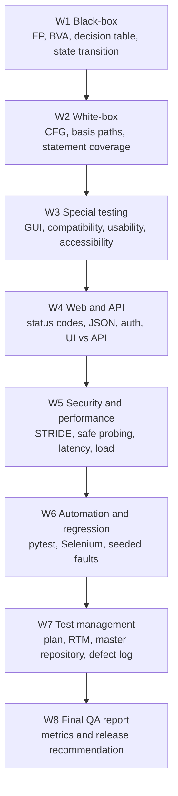

# Test Strategy: PyTodo Pro

| Item | Value |
| --- | --- |
| Course | TEB3433 / TFB3433 - Software Testing and Quality Assurance |
| Deliverable | `/07_Test_Management/test_strategy.md` |
| Companion | [test_plan.md](test_plan.md) (scope, roles, criteria, risks) |

## 1. Purpose

This strategy states how PyTodo Pro is tested: the levels, the design techniques, the tools, the data and environment controls, the rules for choosing what to automate, and the defect workflow. It describes what Weeks 1-6 did.

## 2. Progression

## 3. Levels and techniques

| Week | Level | Techniques | Target | Rationale |
| --- | --- | --- | --- | --- |
| W1 | System, black-box | EP, BVA, decision table, state transition | `REQ-001` to `REQ-008` through the web UI | Tests stated behaviour without reading the code |
| W2 | Unit and integration, white-box | Control-flow graph, cyclomatic complexity, basis paths, statement coverage | 8 functions of `app.py` (`get_db`, `close_connection`, `init_db`, `row_to_task`, `get_category_name`, `get_category_id_by_name`, `login_required_web`, `login_required_api`) and 4 functions of `helpers.py` (`compute_urgency`, `is_valid_password`, `is_valid_username`, `completed_in_last_n_days`) | Finds paths and spec mismatches the black-box cases cannot see |
| W3 | System, presentation | GUI checklist, configuration matrix (2 OS x 2 browsers plus tablet and phone emulation), WCAG 2.2 A/AA subset, two-reviewer heuristic review | Six pages and the shared navigation | Presentation, compatibility and accessibility, not function |
| W4 | Integration, web and API | EP, BVA, decision table, state transition, UI-versus-API comparison | Nine `/api` endpoints and the web forms | Client-server contract and server-side validation |
| W5 | Non-functional (security and performance) | STRIDE threat table (22 threats); safe probing with pytest and `requests` (23 tests); bandit and pip-audit; one manual log check; Locust load steps (1, 5, 10, 25, 50 users), a no-think-time stress run and a data-volume run | Authentication and sessions, task ownership, search, titles, dates, paging, headers and dependencies; the busiest endpoints (`GET /api/tasks`, `/api/dashboard`, `GET /`, search, task writes) | Finds weaknesses the functional weeks only touched through inputs, and shows capacity and how response time scales |
| W6 | Regression | Data-driven pytest, Selenium, seeded-fault check | Core flows, `REQ-001` to `REQ-008` | Fast, repeatable re-checks of the stated behaviour |

Expected results come from the stated requirements, interface text, README and `helpers.py` docstrings, never from the observed behaviour. W4 added `REQ-009` and fixed its error contract before testing: invalid input → 400 with a JSON body; missing or foreign resource → 404; not logged in → 401; unsupported method → 405; duplicate username → 409 or 400; a 500 is never acceptable for client input, and a failed request must not change stored data.

**W5 rules.** Expected results were written before execution. Performance success criteria were set before the run (at 25 users: median < 200 ms, p95 < 1000 ms, errors < 1%); the stress and data-volume experiments were added after `PERF-05` and before they ran. Payloads only detect a weakness: no data was dumped, no hashes were cracked and the Werkzeug debugger console was not used. The scripts refuse any host except `127.0.0.1`. `conftest.py` maps confirmed findings to defect IDs as strict xfail, and `--raw` shows them as failures.

## 4. Environment and data

- Application runs locally (`127.0.0.1`) from `app.py`; the code is never changed.
- Database isolation depends on the phase: temporary file per test (W2); emptied main database (W4); temporary database per run on port 5006 (W6); retained development database with dedicated accounts (W1).
- Accounts are synthetic. Dates are relative to the run day where the phase allows (W3, W4, W6).
- Environments by week are listed in [test_plan.md](test_plan.md), Section 4.1.
- W5: fresh database, throwaway accounts, local host only; the load generator ran on the same VM as the server (see [test_plan.md](test_plan.md), Section 4.1).
- Evidence (screenshots, runner JSON, pytest logs, results files) is stored under each week's `evidences/` folder.

## 5. Automation and regression

### 5.1 Selection rule (W6)

Each group of manual cases was scored 1 to 3 on four criteria: **Repetition**, **Stability**, **Criticality** and **Regression value** (maximum 12). A group is automated when the total is at least 9 **and** an exact oracle exists (the result can be checked by a program without human judgement). Groups scoring 7 or 8 are automated only for the part with an exact oracle. Visual, usability and accessibility checks scored low and stay manual or in the W3 scripts.

Outcome: all 44 W1 cases and the functional parts of 10 W3 GUI cases became 28 automated cases (65 pytest checks).

### 5.2 Design decisions

Preconditions are seeded through the API; the API is an independent oracle; the server runs on a temporary database; tests are data-driven (`parametrize`, with the manual case ID as the row ID); only explicit waits; locators in one file.

### 5.3 Regression policy

| Tier | Selection | Checks | When |
| --- | --- | --- | --- |
| Smoke | `-m smoke` | 11 | Every change |
| Rules | `-m unit` (no browser) | 17 | Changes to `helpers.py` |
| Full | all | 65 | Before merge, after a fix, before submission |
| Defect view | `--defects-as-failures` | 65 | Metrics reporting |

Known defects are kept as strict xfail that expects the specified result: a fix shows as XPASS (Retest); `raises=AssertionError` means any other error still fails. The gate is **0 unexpected failures** (the full suite shows 58 passes and 7 known-defect failures, 89.23%). Effectiveness is shown by 7 seeded-fault runs (M1 to M7), all detected; M6 is a fix of `DEF-001`, reported as Retest.

The suite predates the W4 failures, so new cases for `DEF-014` to `DEF-023` and for the W3 defects are to be added with the same markers (W4 recommends pytest with the Flask test client). W5's `test_security.py` already uses the same strict-xfail pattern for the security findings (normal run: 6 passed, 17 xfailed) and is to be added to this suite; performance has no regression test.

## 6. Defect management

1. **Lifecycle:** `Open` → `Confirmed` → `Retest` → `Closed`. `Confirmed` means reproduced twice (a second run or phase). Because the application is frozen, `Retest` and `Closed` are not expected.
2. **Severity** (the W4 scale, applied to W3):
   - `Critical`: data loss, or a user loses access to their own data.
   - `Major`: account integrity broken, a server error on ordinary input, or a task that cannot be completed with assistive technology.
   - `Moderate`: wrong or misleading behaviour, a materially harder task, or a crash on unusual input.
   - `Minor`: wrong status code, documentation mismatch, or cosmetic.
   - W5 applied `Critical` to unauthorised access to other users' data (`DEF-028`, `DEF-029`), which the wording above does not name; the group should confirm adding it to the `Critical` definition.
3. **Priority** (`High`, `Medium`, `Low`): likelihood and visibility. `DEF-002` is Moderate but High priority because it misleads users about deadlines.
4. **Traceability:** each `DEF-nnn` links to its failing case IDs ([master_test_cases.md](master_test_cases.md)) and requirement ([rtm.md](rtm.md)). Usability observations (`USA-OBS-nnn`) are logged separately and become a defect only when they break a stated requirement.
5. Use one shared ID series; check earlier weeks before assigning a new ID.

## 7. Quality measures and exit criteria

Test-completion and quality-gate criteria are in [test_plan.md](test_plan.md) Sections 7.3 and 7.4. The release gate on Critical defects is reported as **not met** and recorded as accepted risk, since the application cannot be changed.

Week 8 can report: pass rate by phase and by counting unit, defects by severity and by requirement, security findings by STRIDE category, performance capacity and scaling, defect density per requirement or per size measure, statement coverage, and automation detection rate. **Defect removal efficiency cannot be computed**, because it needs defects found after release and PyTodo Pro has no post-release data; Week 8 states this and does not estimate it.
