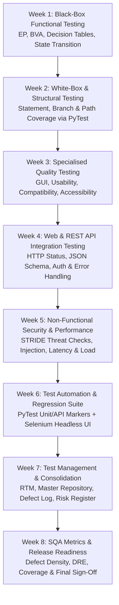

# Test Strategy - PyTodo Pro

**Project:** PyTodo Pro (TEB3433 / TFB3433 Software Quality & Testing)  
**Deliverable:** `/07_Test_Management/test_strategy.md`  
**Prepared By:** Defect & Metrics Coordinator  

---

## 1. Purpose
This Test Strategy defines the technical testing approach, test levels, test design techniques, tooling, environment controls, automation selection rules, and defect management workflow applied across **Weeks 1–6** for **PyTodo Pro**. It complements [`test_plan.md`](test_plan.md) (which defines scope, schedule, roles, entry/exit criteria, and risks).

---

## 2. End-to-End Testing Progression Flowchart

---

## 3. Test Levels & Technique Selection Matrix

| Week | Test Phase / Level | Techniques Applied | Target Scope in PyTodo Pro | Rationale |
| :--- | :--- | :--- | :--- | :--- |
| **W1** | System / Functional (Black-Box) | Equivalence Partitioning (EP), Boundary Value Analysis (BVA), Decision Tables, State Transition | Auth (`REQ-001`–`REQ-002`), Task CRUD (`REQ-003`), Status/Filters/Search (`REQ-004`–`REQ-006`), Export (`REQ-007`), Admin (`REQ-008`) | Validates user-facing functional requirements and boundary inputs without relying on internal source code. |
| **W2** | Unit / Structural (White-Box) | Statement Coverage, Branch/Decision Coverage, Path Testing, Control-Flow Analysis | `utils.py`, `models.py`, `auth.py`, `tasks.py`, `admin.py` (`REQ-001`–`REQ-009`) | Exposes hidden logic branches, edge cases (e.g., `validate_password`, `can_access_task`), and unexercised error paths. |
| **W3** | System / Specialised UI & UX | Heuristic Evaluation, Cross-Browser Matrix, Responsive Viewport Checks, WCAG Accessibility | Web templates (`base.html`, `dashboard.html`, `login.html`, `register.html`, `admin.html`) | Ensures layout consistency, keyboard navigation, form clarity, and browser compatibility across devices. |
| **W4** | Integration / Web & API | HTTP Method/Status Testing, JSON Payload Validation, Session & Authorization Checks | REST endpoints (`/api/tasks`, `/api/tasks/<id>`, `/api/admin/...`) and form routes | Verifies client-server contracts, HTTP error codes (`400`, `401`, `403`, `404`, `405`), and cross-user isolation. |
| **W5** | Non-Functional (Security & Performance) | STRIDE Threat Modelling, XSS/SQLi/CSRF Probing, Response-Time & Concurrency Checks | Login/session handling, task input fields, admin endpoints, bulk task queries | Identifies security vulnerabilities (e.g., unescaped output, missing rate limits) and performance bottlenecks. |
| **W6** | Automated Regression | Smoke Suite (`-m smoke`), Unit Suite (`-m unit`), Headless Browser E2E (`Selenium`) | High-risk core flows (login, task create/toggle/delete, filtering, admin access control) | Prevents regressions quickly and verifies fault-detection effectiveness via seeded defect injection (`7/7` caught). |

---

## 4. Test Environment & Data Management Strategy

* **Application Runtime:** Local Flask server (`Python 3.x`, `127.0.0.1:5000`) running in isolated test mode.
* **Database Isolation:** Automated and white-box tests instantiate temporary SQLite databases (`tmp_path` fixtures in PyTest) seeded with deterministic user accounts (`admin`, standard users `user1`/`user2`) and sample tasks. Production/dev data is never mutated during test runs.
* **Browser & Automation Stack:**
  * Manual UI/Web testing on desktop browsers (Chrome, Edge, Firefox) and mobile viewport emulation.
  * Automated UI regression executed via **Selenium WebDriver (Microsoft Edge headless)** with deterministic waits.
* **Evidence Capture:** Every failed test case and logged defect includes reproducible evidence (PyTest traceback, HTTP response payload/status, or UI screenshot) stored in the corresponding weekly folder (`01_Black_Box` through `06_Automation_Regression`).

---

## 5. Automation & Regression Strategy

### 5.1 Candidate Selection Criteria
Test cases were selected for Week 6 automation based on three criteria:
1. **Business Criticality:** Authentication, task lifecycle CRUD, and authorization boundaries (`REQ-001` to `REQ-004`).
2. **Defect History:** Features with confirmed defects in Weeks 1–4 (e.g., filtering, due-date handling, access control).
3. **Repeatability:** Deterministic tests suitable for fast execution via PyTest markers (`smoke`, `unit`, `api`, `ui`).

### 5.2 Regression Execution Policy
* **Smoke Gate (`pytest -m smoke`):** Run first on any build change to verify app boot, login, and basic task creation.
* **Full Automated Regression (`65 checks`):** Executed before milestone sign-off; results tracked separately from unique planned test cases (`155`) in [`execution_summary.md`](execution_summary.md) to avoid double-counting.
* **Defect Injection Validation:** Seeded defects (`7` injected faults in Week 6) are used to measure test-suite fault detection capability (`100%` detection rate achieved).

---

## 6. Defect Management & Triage Workflow

All defects across Weeks 1–6 follow a standardised lifecycle and classification scheme in [`defect_log.md`](defect_log.md):

1. **Lifecycle States:** `Open` $
ightarrow$ `Confirmed` $
ightarrow$ `Retest` $
ightarrow$ `Closed`.
2. **Severity Scale (Technical Impact):**
   * `Critical`: Security breach, crash, data loss, or complete blockage of core feature with no workaround.
   * `Major`: Core functional failure or unhandled server error (`500`) affecting key workflows.
   * `Moderate`: Partial feature malfunction or misleading behavior with an available workaround.
   * `Minor`: Cosmetic, wording, or low-impact UI/validation inconsistency.
3. **Priority Scale (Fix Urgency):** `High`, `Medium`, `Low` — assigned based on user impact and release risk (e.g., `DEF-002` has `Moderate` severity but `High` priority because login lockout affects all users).
4. **Traceability Rule:** Every defect ID (`DEF-XXX`) must map back to its failing Test Case ID(s) in [`master_test_cases.md`](master_test_cases.md) and Requirement ID (`REQ-XXX`) in [`rtm.md`](rtm.md).

---

## 7. Quality Exit Criteria for Release Readiness
To recommend PyTodo Pro for release at the end of Week 8, the following thresholds apply:
* **100%** of planned requirements (`REQ-001`–`REQ-009`) mapped in [`rtm.md`](rtm.md) and executed.
* **0** unresolved `Critical` defects (or formal documented risk acceptance/waiver in [`risk_register.md`](risk_register.md) if source code is frozen for assessment).
* **$\ge$ 90%** pass rate on automated regression checks (`100%` achieved in Week 6).
* Complete consolidation of Weeks 1–6 test cases, defects, and execution metrics in `/07_Test_Management`.
