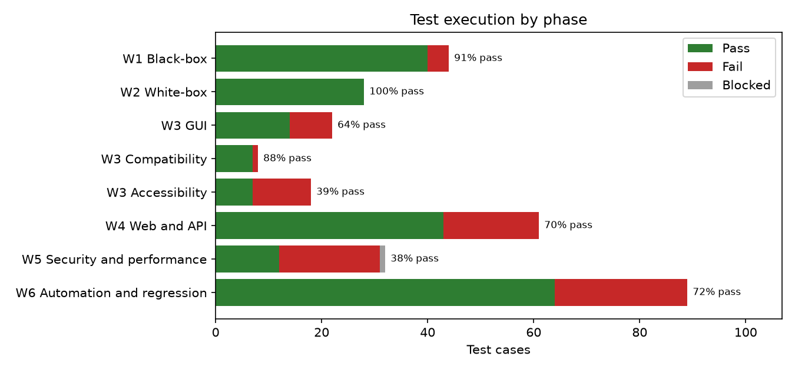
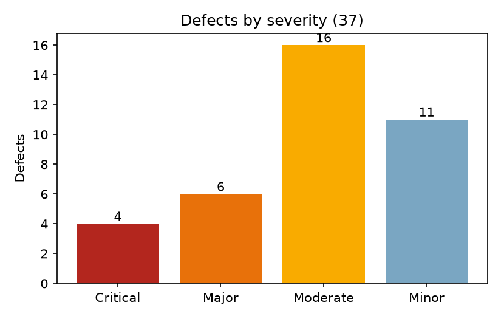
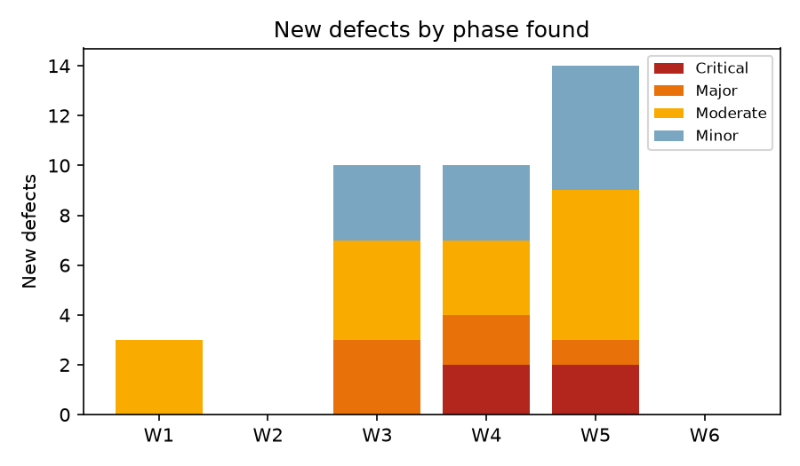
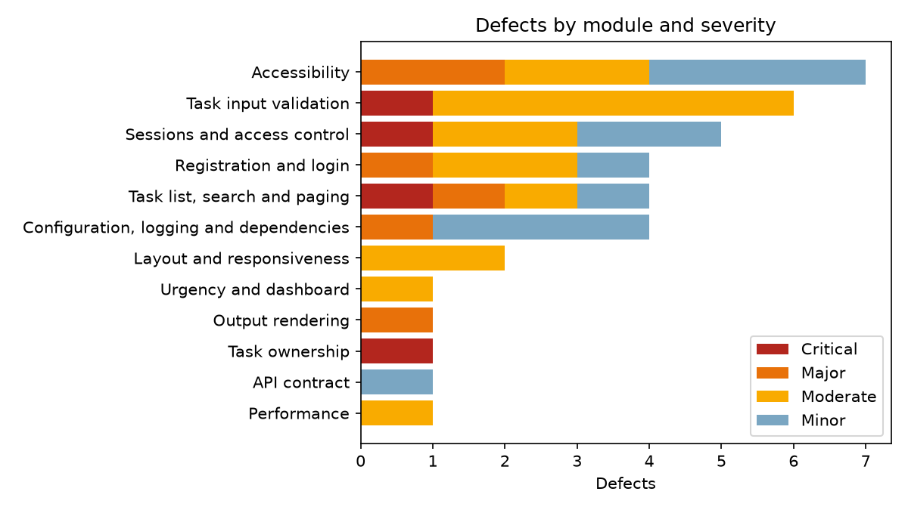

# Week 8 - SQA, Metrics and Final Quality Evaluation

| Item | Value |
| --- | --- |
| Course | TEB3433 / TFB3433 - Software Testing and Quality Assurance, September 2026 |
| Lab group | Wednesday Lab - Group 2 |
| Phase owner | Darius Lee Shin, Mohamad Shukri Bin Abdul Ajed |
| Evaluation date | 2026-11-27, covering Weeks 1-7 |
| Build under test | `app.py` SHA-256 `050b4ee4...f30f`, `helpers.py` `bf914033...6d80`; unchanged throughout the project |
| Sources | [Master test-case repository](../master_test_cases.md), [RTM](../rtm.md), [consolidated defect log](../consolidated_defect_logs.md), weekly reports |

## Deliverable checklist

- [x] [Final integrated QA evaluation](#1-overall-quality-assessment)
- [x] [Metrics tables/charts](#2-metrics) - full tables in [metrics.md](metrics.md), charts in [evidences/](evidences/)
- [x] [Residual risk assessment](#4-residual-risk-assessment)
- [x] [Quality findings and limitations](#5-quality-findings-and-limitations)
- [x] [Prioritised recommendations and future testing](#7-prioritised-recommendations-and-future-testing)

## 1. Overall quality assessment

PyTodo Pro does what it is supposed to do on the **normal path**: registration, login, task create/edit/complete/delete, filters, dashboard and user separation in the web pages all work in Chrome and Firefox on macOS and Windows, and at expected load it answers in under 10 ms (p95) with no errors.

It is **not ready for release to real users.** Testing found 37 open defects, 4 Critical and 6 Major. The Critical ones break the two things a task manager must protect: **who can act on an account** (forged sessions with the hard-coded key, DEF-028) and **whose data a user can reach** (SQL injection in API search, DEF-029; deleting another user's task through the API, DEF-014; one bad due date locking a user out of their own list, DEF-015). Most of these sit in the JSON API, which validates and authorises less carefully than the web pages, and none needs specialist tools to trigger.

71.2% of 302 executed cases passed, and the areas in section 4 remain partly or wholly untested. Testing shows that defects are present; it does not show that the software is defect-free.

## 2. Metrics

### 2.1 Test execution

| Phase | Cases | Pass | Fail | Blocked | Not Run | Pass rate |
| --- | ---: | ---: | ---: | ---: | ---: | ---: |
| Week 1 Black-box | 44 | 40 | 4 | 0 | 0 | 90.9% |
| Week 2 White-box | 28 | 28 | 0 | 0 | 0 | 100.0% |
| Week 3 GUI | 22 | 14 | 8 | 0 | 0 | 63.6% |
| Week 3 Compatibility | 8 | 7 | 1 | 0 | 0 | 87.5% |
| Week 3 Accessibility | 18 | 7 | 11 | 0 | 0 | 38.9% |
| Week 4 Web and API | 61 | 43 | 18 | 0 | 0 | 70.5% |
| Week 5 Security and performance | 32 | 12 | 19 | 1 | 0 | 37.5% |
| Week 6 Automation and regression | 89 | 64 | 25 | 0 | 0 | 71.9% |
| **Total** | **302** | **215** | **86** | **1** | **0** | **71.2%** |

Execution rate 100% (302 of 302); blocked rate 0.3% (PERF-06b, test-machine port limit). Without the Week 6 automated re-runs: 213 cases, 70.9% pass. The 4 usability observations are not counted as cases.

**Interpretation.** Pass rates follow the depth of the attack on each area, not its overall quality: white-box tests of eight small functions all pass, the normal-path black-box tests pass 91%, while accessibility (39%) and security (25% of security cases) fail most because they test properties the application was never built to have (labels, CSRF tokens, rate limits). The Week 6 automated cases reproduce exactly the verdicts of the manual cases they automate, which confirms no regression.

### 2.2 Defects

| Severity | High | Medium | Low | Total |
| --- | ---: | ---: | ---: | ---: |
| Critical | 4 | 0 | 0 | 4 |
| Major | 6 | 0 | 0 | 6 |
| Moderate | 1 | 13 | 2 | 16 |
| Minor | 0 | 0 | 11 | 11 |
| **Total** | **11** | **13** | **13** | **37** |

 

| Metric | Value | Interpretation |
| --- | --- | --- |
| Defect density | 37 / 557 lines = **66 per KLOC** | High for a small application; partly because non-functional testing was deep relative to code size |
| Critical + Major | 10 of 37 (27%) | All 10 are High priority |
| Defects by phase | W1 3, W3 10, W4 10, W5 14 | Each new technique found new defects; Weeks 2 and 6 found none because they re-test known behaviour |
| Modules with most defects | Accessibility 7, task input validation 6, sessions/access control 5 | The 4 Critical defects are in validation (DEF-015), sessions (DEF-028), ownership (DEF-014) and search (DEF-029) |
| Status | 37 open, 0 closed | No fixes were delivered (the project does not modify the application) |

### 2.3 Coverage and automation

| Measure | Result | Interpretation |
| --- | --- | --- |
| Statement coverage, `helpers.py` | 100% (31/31) | Every rule executed; still encodes DEF-001 and DEF-002, so coverage did not mean correctness |
| Statement coverage, 8 selected `app.py` functions | 100% (31/31); 19/19 basis paths | Structural objective met for the selected units |
| Statement coverage, whole `app.py` | 45.5% (136/299) by the Week 2 unit suite | Routes were covered by the system-level suites instead (Weeks 1, 4, 6) |
| Manual functional cases automated | 105 of 105 (Week 1 and Week 4) + functional parts of 10 GUI cases | 89 automated cases, 166 checks, ~85 s per full run |
| Regression stability | Identical verdicts in 3 repeat runs per tier | No flaky checks |
| Seeded faults detected | 12 of 12 (100%) | The suite detects realistic regressions and reports fixes as Retest |
| Requirements traced | 14 of 14 (REQ-001 to REQ-014) | Every requirement has executed cases or observations |

## 3. Consolidated evidence by quality characteristic (ISO/IEC 25010)

| Characteristic | Evidence | Verdict |
| --- | --- | --- |
| Functional suitability | W1 40/44, W4 43/61; DEF-001, 002, 003, 015, 016, 018 to 022 | Correct on the normal path; weak at boundaries and on invalid input, especially in the API |
| Compatibility | W3 46/48 configuration runs pass on 2 OS × 2 engines | Good on desktop; layout fails on tablet and phone (DEF-006) |
| Usability / interaction capability | W3 4 observations (2 Minor, 2 Cosmetic); GUI 14/22 | Usable; weak feedback and inconsistent styling; no blocking issue |
| Accessibility (part of usability) | W3 7/18 WCAG checks pass; axe/Lighthouse 76-100 | Poor: 7 defects, 2 Major (unlabelled fields, unnamed toggle) |
| Security | W5 6/24 pass; STRIDE 22 threats, 6 mitigated | Poor: 4 Critical defects, debug mode on, no CSRF or rate limiting |
| Performance efficiency | W5 load 1-50 users p95 ≤ 9 ms, 0 errors; saturation ~790 req/s; p95 > 1 s between 100 and 200 users | Good at expected load; home page scales linearly with data (DEF-037) |
| Reliability | Graceful slowdown under stress, no server errors to 200 users; but one bad date makes a user's pages fail (DEF-015) | Mixed: robust to load, fragile to bad data |
| Maintainability | Week 2 CFGs show low complexity (V(G) ≤ 3); web and API duplicate logic and have drifted apart | Simple code, but duplicated rules are the root of several defects |

## 4. Residual risk assessment

Residual risk = what remains if the application were released as tested (likelihood × impact, 1-3 each).

| # | Residual risk | Linked defects | Likelihood | Impact | Rating | Mitigation before release |
| --- | --- | --- | ---: | ---: | --- | --- |
| RR-01 | Account takeover by forging a session cookie | DEF-028, 026 | 3 | 3 | **High (9)** | Secret key from the environment; server-side sessions |
| RR-02 | Reading all users' tasks through API search | DEF-029, 017 | 3 | 3 | **High (9)** | Parameterised query |
| RR-03 | Users deleting each other's tasks through the API | DEF-014, 021 | 3 | 3 | **High (9)** | Owner check on delete; 404 for missing tasks |
| RR-04 | A user locked out of their own list by bad data | DEF-015, 018, 019, 020 | 3 | 3 | **High (9)** | Server-side validation of every field |
| RR-05 | Script injection through task titles | DEF-005, 030 | 2 | 3 | High (6) | Escape output; CSRF tokens |
| RR-06 | Server internals exposed on errors | DEF-031 | 3 | 2 | High (6) | Debug off; generic error pages |
| RR-07 | Password guessing; weak passwords | DEF-024, 027, 001 | 2 | 2 | Medium (4) | Rate limiting; password policy; fix the 8-character boundary |
| RR-08 | Screen-reader and keyboard users unable to use forms | DEF-007, 008, 011 | 2 | 2 | Medium (4) | Labels, accessible names, announced errors |
| RR-09 | Misleading deadlines (today shown as overdue) | DEF-002 | 3 | 1 | Medium (3) | Fix the date comparison |
| RR-10 | Unusable on phones and tablets | DEF-004, 006 | 2 | 1 | Low (2) | Viewport tag and responsive navigation |
| RR-11 | Slow pages for users with many tasks | DEF-037, 034 | 1 | 2 | Low (2) | Paging, joined queries, capped page size |

### Important untested areas

| Area | Why untested | Risk |
| --- | --- | --- |
| Real mobile devices, Safari/WebKit, Edge | Not available / excluded | Rendering and touch issues on iOS |
| Screen-reader use | Out of scope | Accessibility defects beyond those found |
| Production setup (WSGI server, HTTPS, real network) | App supplied with a dev server only | Different performance and transport security |
| Long-running use (soak), database growth | Short runs only | Memory or data-size problems |
| Concurrent edits of the same task | Not designed | Lost updates |
| Session expiry, password change, account deletion | Features absent or undocumented | Unknown |
| Real end-user usability testing | Team members only | Usability problems of non-technical users |

## 5. Quality findings and limitations

### 5.1 Findings

1. **The API is the weakest layer.** It accepts invalid types, dates and categories (DEF-015, 018, 019, 020), skips the ownership check on delete (DEF-014), builds SQL from user text (DEF-017, 029) and is reachable without login for categories (DEF-023). The web pages get several of these right, which shows the rules were known but not shared.
2. **Insecure defaults dominate the security results.** A hard-coded secret key, debug mode, no CSRF tokens, no rate limiting, no security headers and an outdated Flask version (DEF-024 to 036) are configuration choices, cheap to fix but each exploitable today.
3. **Specification boundaries are off by one.** The 8-character password (DEF-001) and the due-today label (DEF-002) contradict the interface text and docstrings; the white-box suite even asserted the wrong behaviour, showing that tests written from code repeat its mistakes.
4. **Accessibility was not considered in the templates.** Seven defects come from missing labels, names, landmarks and announcements, which automated scanners only partly detect.
5. **Normal-path quality is good.** Core workflows, filters, the dashboard (apart from DEF-002), cross-browser behaviour and performance at expected load all passed consistently, and no regression appeared during the project.

### 5.2 Limitations of this evaluation

- Tests ran on local development servers on three different machines; results are not production measurements.
- Expected API error codes (400/404/409) are a team decision because the README defines no error contract.
- Tablet and phone results are emulated; usability users were team members.
- Security tests show that weaknesses exist; they do not measure full exploitability, and no penetration testing was done.
- Defect counts depend on test depth: areas tested more deeply (security, accessibility) naturally show more defects.
- Pass rates count cases, not checks; one case can contain several variants.

## 6. Process improvements to prevent recurrence

| QA activity | Would have prevented | How |
| --- | --- | --- |
| Requirements review with explicit acceptance criteria and an API error contract | DEF-001, 002, 021, 022, 023 | Boundaries and status codes agreed before coding |
| Shared validation and data-access layer, enforced by code review | DEF-003, 014, 015, 017 to 020, 029 | Web and API use one implementation of each rule and query |
| Secure-coding checklist and static analysis (bandit) in CI | DEF-028, 029, 031 | Hard-coded secrets, string-built SQL and `debug=True` flagged on every commit |
| Dependency scanning (pip-audit) in CI | DEF-036 | Vulnerable versions flagged automatically |
| Requirements-based unit tests at boundaries | DEF-001, 002 | Tests derived from the specification, not from the code |
| Accessibility linting (axe) in CI and an accessible-template checklist | DEF-007 to 013 | Labels and names checked on every template change |
| Regression suite in CI: smoke on every commit, full suite before merge (Week 6) | Future regressions | Already built; needs a pipeline (Week 9) |
| Performance check on data volume in the definition of done | DEF-037 | Paging and query count reviewed before release |

## 7. Prioritised recommendations and future testing

### 7.1 Fixes (development team)

| Priority | Recommendation | Defects |
| --- | --- | --- |
| 1 | Parameterise the API search query | DEF-029, 017 |
| 2 | Load the secret key from the environment; revoke sessions on logout | DEF-028, 026 |
| 3 | Check task ownership on API delete; return 404 for missing tasks | DEF-014, 021 |
| 4 | Validate every field on the server for both web and API (title, type, length, date, category, paging) | DEF-003, 015, 018, 019, 020, 022, 033, 034 |
| 5 | Turn debug mode off; add security headers, CSRF tokens, `SameSite` cookies and login rate limiting; upgrade Flask | DEF-024, 025, 030, 031, 032, 036 |
| 6 | Escape task titles | DEF-005 |
| 7 | Fix the 8-character password boundary and the due-today label; enforce unique usernames | DEF-001, 002, 016 |
| 8 | Add labels, accessible names, landmarks and announced errors; enlarge targets | DEF-007 to 013 |
| 9 | Add a viewport tag and responsive navigation; page the task list and join categories in one query | DEF-004, 006, 037 |
| 10 | Log security events with the user; require login for categories | DEF-035, 023 |

### 7.2 Future testing

1. **Retest every fix** with the Week 6 suite: a fixed defect shows as Retest (XPASS); close it and remove its marker.
2. **Run the regression suite, bandit, pip-audit and the axe scan in CI** on every change (Week 9 integration).
3. Re-run the JMeter load and stress tests on a production-like setup (WSGI server, separate load-generator machine) and add a soak test.
4. Test on real iOS and Android devices and with a screen reader.
5. Run a usability study with real end users.
6. Add tests for concurrent edits, session expiry and very large data sets once those behaviours are specified.
